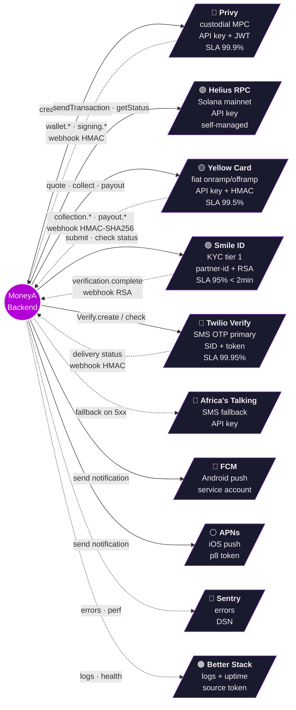
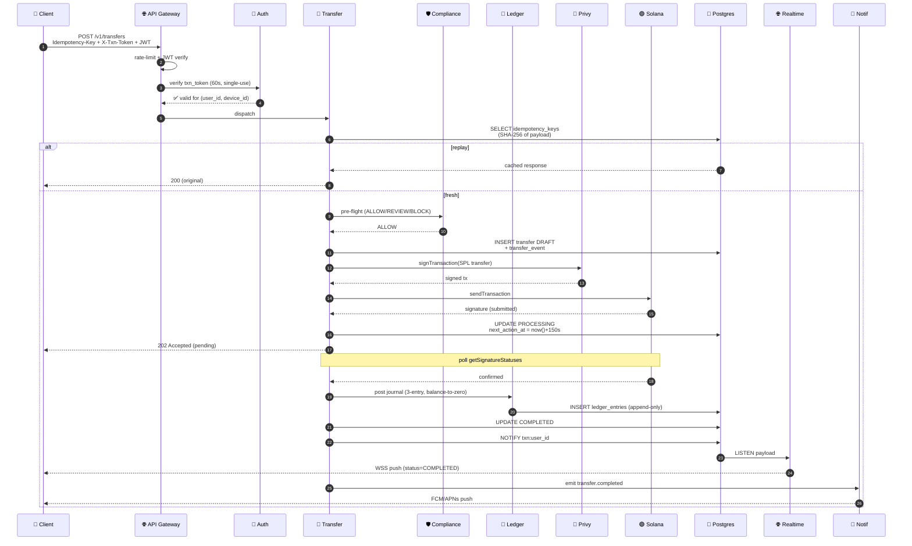

# MoneyA — Backend Architecture Diagram

> ⚠️ **Partially superseded.** MoneyA now settles on **Stellar** with **pooled custody**, and the API is **fiat-only** — users must never learn that stablecoins are used. Solana / Privy / SPL parts of this document no longer apply. See [`stellar-mvp-plan.md`](./stellar-mvp-plan.md) §1.1 and **Appendix B** for exactly what changed.

> **Audience:** backend developer building Phase 1.
> **Purpose:** single-page visual reference. Pin this on the wall.
> **Companion docs:** [`architecture.md`](./architecture.md) (prose), [`openapi.yaml`](./openapi.yaml) (wire contract), [`transfer-state-machine.md`](./transfer-state-machine.md) (FSM), [`ledger.md`](./ledger.md) (journals), [`webhooks.md`](./webhooks.md) (inbound), [`backlog.md`](./backlog.md) (sprint plan).
>
> **v1 deployment reality:** every box inside `MoneyA Backend` below is a **NestJS module in a single monolith** on Supabase (Phase 1) → AWS af-south-1 (Phase 2). Service boundaries shown are module boundaries — they exist so v2 extraction is `nest g app` away. Don't run nine processes on day one.

---

## 1. Component diagram (single source of truth)

Component-level: every NestJS module + every third party + every datastore + every queue + every cache, with all arrows labelled by protocol or event.

```mermaid
flowchart LR
  %% =============== CLIENT ===============
  subgraph CLIENT["📱 Flutter Client"]
    direction TB
    APP["MoneyA App<br/>Riverpod 2 · dio · WSS<br/>flutter_secure_storage"]
  end

  %% =============== EDGE ===============
  subgraph EDGE["🌐 Edge"]
    GW["API Gateway<br/>(Supabase Edge → ALB v2)<br/>JWT verify · rate-limit · CORS<br/>Idempotency-Key replay cache"]
    WSS["Realtime Channel<br/>(Supabase Realtime → AppSync v2)<br/>per-user txn status"]
    WHK_ING["Webhook Ingress<br/>raw-body · HMAC verify<br/>/webhooks/:provider"]
  end

  %% =============== BACKEND MONOLITH ===============
  subgraph BE["🧱 MoneyA Backend (NestJS monolith v1 → microservices v2)"]
    direction TB

    subgraph CORE["Core domain modules"]
      AUTH["🔐 Auth Module<br/>OTP · JWT RS256<br/>Argon2id passcode<br/>device binding · txn_token"]
      KYC["🪪 KYC Module<br/>tier 0/1 orchestration<br/>doc upload metadata"]
      WAL["👛 Wallet Module<br/>Privy provisioning<br/>balance cache 30s<br/>address book"]
      TXF["💸 Transfer Module<br/>P2P · onramp credit · offramp debit<br/>FSM owner · escrow · SPL signer"]
      ON["⬇️ Onramp Module<br/>YC quote → collect → mint"]
      OFF["⬆️ Offramp Module<br/>SPL pull → YC payout"]
      LED["📒 Ledger Module<br/>double-entry append-only<br/>daily reconciliation"]
      CMP["🛡 Compliance Module<br/>velocity · sanctions · AML"]
      NOT["🔔 Notification Module<br/>FCM · APNs · SMS claim links<br/>i18n FR/EN"]
      WHK_DSP["📥 Webhook Dispatcher<br/>YC · Smile · Privy · Twilio<br/>dedupe by event_id"]
    end

    subgraph WORK["Workers (pg-boss v1 → SQS v2)"]
      RES["⏰ Resumer Worker<br/>scans next_action_at<br/>retries R1-R4"]
      REC["🧮 Reconciler Worker<br/>nightly ledger ⇄ chain ⇄ YC"]
      EXP["⏳ Expiry Worker<br/>claim-link 7d · quote 60s · txn_token 60s"]
      NOT_W["📤 Notification Worker<br/>FCM/APNs delivery"]
    end
  end

  %% =============== DATA ===============
  subgraph DATA["💾 Data plane"]
    PG[("🐘 Postgres 15<br/>Supabase v1 → RDS v2<br/>schemas: app · audit<br/>RLS ON · pg-boss queue")]
    BLOB[("🗄 Object Storage<br/>Supabase Storage → S3 v2<br/>KYC docs · per-user RLS<br/>encrypted at rest")]
    VAULT[("🔑 Secrets<br/>Supabase Vault → AWS KMS v2<br/>API keys · webhook secrets")]
    CACHE[("⚡ Cache<br/>Postgres v1 → ElastiCache v2<br/>balance 30s · quote 60s")]
  end

  %% =============== THIRD PARTIES ===============
  subgraph TP["🌍 Third-party providers"]
    direction TB
    PRIVY[["🔷 <b>Privy</b><br/>custodial MPC wallets<br/>Solana signer<br/>API key + JWT"]]
    SOL[["🟣 <b>Solana RPC</b> (Helius)<br/>USDC SPL mint<br/>EPjFW…TDt1v<br/>Helius EU+US · Triton fallback"]]
    YC[["🟡 <b>Yellow Card</b><br/>onramp · offramp · FX<br/>XOF/XAF/NGN/GHS/KES<br/>API key + HMAC"]]
    SMILE[["🟢 <b>Smile ID</b><br/>KYC tier-1<br/>ID + selfie liveness<br/>partner-id + RSA"]]
    TWI[["📱 <b>Twilio Verify</b><br/>phone OTP primary<br/>SID + auth token"]]
    AT[["📡 <b>Africa's Talking</b><br/>SMS OTP fallback<br/>API key"]]
    FCM[["🔵 <b>FCM</b> (Android)<br/>service account JSON"]]
    APNS[["⚪ <b>APNs</b> (iOS)<br/>p8 token"]]
  end

  %% =============== OBSERVABILITY ===============
  subgraph OBS["👁 Observability"]
    SEN["Sentry<br/>errors + perf"]
    BS["Better Stack<br/>logs + uptime"]
    OTEL["OTel collector<br/>traceparent propagation"]
  end

  %% =============== EDGES: client → edge ===============
  APP -- "REST · HTTPS<br/>JWT bearer<br/>Idempotency-Key<br/>X-Txn-Token" --> GW
  APP <-. "WSS subscribe<br/>txn updates" .-> WSS

  %% =============== EDGES: edge → core ===============
  GW --> AUTH
  GW --> KYC
  GW --> WAL
  GW --> TXF
  GW --> ON
  GW --> OFF
  GW --> NOT
  WSS --> PG

  %% =============== EDGES: webhooks inbound ===============
  YC -- "payout.* · collection.*<br/>HMAC-SHA256" --> WHK_ING
  SMILE -- "verification.complete<br/>RSA sig" --> WHK_ING
  PRIVY -- "wallet.* · signing.*<br/>HMAC" --> WHK_ING
  TWI -- "delivery status<br/>HMAC" --> WHK_ING
  WHK_ING --> WHK_DSP
  WHK_DSP --> TXF
  WHK_DSP --> ON
  WHK_DSP --> OFF
  WHK_DSP --> KYC

  %% =============== EDGES: core ↔ third parties ===============
  AUTH -- "Verify.create / check<br/>HTTPS" --> TWI
  AUTH -. "5xx fallback" .-> AT
  KYC -- "submit job<br/>partner-id" --> SMILE
  WAL -- "createWallet<br/>POST /wallets" --> PRIVY
  TXF -- "signTransaction<br/>POST /wallets/:id/rpc" --> PRIVY
  TXF -- "sendTransaction<br/>getSignatureStatuses" --> SOL
  ON -- "POST /collections<br/>quote · collect" --> YC
  OFF -- "POST /payouts<br/>quote · payout" --> YC
  NOT_W -- "send" --> FCM
  NOT_W -- "send" --> APNS
  NOT_W -- "claim-link SMS" --> TWI

  %% =============== EDGES: core ↔ data ===============
  AUTH --> PG
  KYC --> PG
  KYC -- "doc bytes" --> BLOB
  WAL --> PG
  WAL -- "balance 30s TTL" --> CACHE
  TXF --> PG
  TXF -- "quote 60s · txn_token 60s" --> CACHE
  ON --> PG
  OFF --> PG
  LED --> PG
  CMP --> PG
  NOT --> PG
  WHK_DSP --> PG

  %% =============== EDGES: core → ledger ===============
  TXF -- "post journal<br/>(see ledger.md)" --> LED
  ON -- "post journal" --> LED
  OFF -- "post journal" --> LED

  %% =============== EDGES: core → compliance ===============
  TXF -- "pre-flight<br/>ALLOW/REVIEW/BLOCK" --> CMP
  ON -- "pre-flight" --> CMP
  OFF -- "pre-flight" --> CMP

  %% =============== EDGES: core → notifications ===============
  TXF -- "transfer.completed<br/>transfer.failed" --> NOT
  ON -- "onramp.collected" --> NOT
  OFF -- "offramp.settled" --> NOT
  KYC -- "kyc.tier_changed" --> NOT
  NOT --> NOT_W

  %% =============== EDGES: workers ===============
  RES -- "scan transfers<br/>WHERE next_action_at <= now()" --> PG
  RES -- "resume FSM" --> TXF
  REC -- "reconcile<br/>ledger ⇄ chain ⇄ YC" --> LED
  REC -- "balance check" --> SOL
  REC -- "settlement reports" --> YC
  EXP -- "expire claims · quotes · tokens" --> PG

  %% =============== EDGES: secrets ===============
  AUTH -. "fetch secret" .-> VAULT
  WAL -. .-> VAULT
  TXF -. .-> VAULT
  ON -. .-> VAULT
  OFF -. .-> VAULT
  WHK_DSP -. .-> VAULT
  NOT_W -. .-> VAULT

  %% =============== EDGES: realtime broadcast ===============
  TXF -- "NOTIFY pg_channel<br/>txn:user_id" --> PG
  PG -- "LISTEN" --> WSS

  %% =============== EDGES: observability ===============
  BE -. "errors" .-> SEN
  BE -. "logs" .-> BS
  BE -. "traces · metrics" .-> OTEL
  WORK -. .-> SEN
  WORK -. .-> BS

  %% =============== STYLES ===============
  classDef client fill:#2B0033,stroke:#B200D6,stroke-width:2px,color:#F2ECEC
  classDef edge fill:#1a1a2e,stroke:#9d4edd,color:#F2ECEC
  classDef core fill:#16213e,stroke:#4361ee,color:#F2ECEC
  classDef work fill:#0f3460,stroke:#4cc9f0,color:#F2ECEC
  classDef data fill:#3a0ca3,stroke:#7209b7,color:#F2ECEC
  classDef tp fill:#2d3142,stroke:#bfc0c0,color:#F2ECEC
  classDef obs fill:#1d3557,stroke:#a8dadc,color:#F2ECEC

  class APP client
  class GW,WSS,WHK_ING edge
  class AUTH,KYC,WAL,TXF,ON,OFF,LED,CMP,NOT,WHK_DSP core
  class RES,REC,EXP,NOT_W work
  class PG,BLOB,VAULT,CACHE data
  class PRIVY,SOL,YC,SMILE,TWI,AT,FCM,APNS tp
  class SEN,BS,OTEL obs
```

---

## 2. Third-party integration map

One row per provider. **Direction** = who calls whom. **Auth** = how we authenticate. **Failure** = backend behavior on outage.



| Provider | Outbound (we → them) | Inbound (them → us) | Auth | Failure mode | SLA |
|---|---|---|---|---|---|
| **Privy** | `createWallet`, `signTransaction` | `wallet.*`, `signing.*` webhooks | API key + JWT | exp backoff, circuit-breaker → fail txn | 99.9% |
| **Helius (Solana RPC)** | `sendTransaction`, `getSignatureStatuses`, `getTokenAccountsByOwner` | — | API key | multi-region (EU+US), Triton fallback | self-managed |
| **Yellow Card** | quote, collect, payout, balance | `collection.*`, `payout.*` webhooks (HMAC-SHA256) | API key + HMAC | quote-expired → requote; payout-failed → reverse SPL | 99.5% |
| **Smile ID** | submit job, fetch status | `verification.complete` (RSA sig) | partner-id + API key | async; degraded → manual review queue | 95% < 2 min |
| **Twilio Verify** | `Verify.create`, `Verify.check` | delivery status | SID + auth token | fallback to Africa's Talking on 5xx | 99.95% |
| **Africa's Talking** | SMS send (fallback only) | — | API key | best-effort | n/a |
| **FCM** | push (Android) | — | service account JSON | fire-and-forget | n/a |
| **APNs** | push (iOS) | — | p8 token | fire-and-forget | n/a |
| **Sentry** | errors + perf | — | DSN | drop on backpressure | n/a |
| **Better Stack** | logs + uptime | — | source tokens | drop on backpressure | n/a |

---

## 3. Money flow strip diagrams

Compact end-to-end views of each FSM. Read left → right. Numbers are FSM transitions; see [`transfer-state-machine.md`](./transfer-state-machine.md) and [`ledger.md`](./ledger.md) for SQL.

### 3.1 In-network P2P (MoneyA → MoneyA)

```
┌────────┐  1.draft  ┌────────┐  2.compliance  ┌─────┐  3.txn_token  ┌─────┐  4.SPL submit  ┌──────┐  5.confirmed  ┌────┐
│ Sender │──────────▶│Transfer│──────────────▶│ CMP │──────────────▶│Privy│──────────────▶│Solana│──────────────▶│ LED│
│ client │           │ module │   ALLOW       │     │   sign         │     │   tx sig       │ RPC  │   journal     │    │
└────────┘           └────────┘                └─────┘                └─────┘                └──────┘  P2P 3-entry  └────┘
                          │                                                                                          │
                          │                                                                       ┌──────┐  6.notify │
                          └──────────────────────────────────────────────────────────────────────▶│ NOT  │◀──────────┘
                                                                                                  └──────┘
                                                                                                      │
                                                                                                      ▼
                                                                                              FCM/APNs both users
```

States: `DRAFT → PROCESSING → COMPLETED` (~ sub-second on healthy RPC).

### 3.2 Onramp (Mobile money → USDC)

```
┌────────┐ 1.quote ┌────┐ 2.order ┌────┐ 3.checkout ┌──────────┐ 4.user pays ┌────┐ 5.webhook ┌──────┐ 6.SPL ┌──────┐ 7.LED
│ User   │────────▶│ ON │────────▶│ YC │───────────▶│ MoMo USSD│────────────▶│ YC │──────────▶│ WHK  │──────▶│Privy │──────▶
│ client │  XOF→USDC│    │ collect │    │ checkout   │ PIN entry│              │    │ collected │ DSP  │ mint  │ +SOL │ DEC-
└────────┘         └────┘         └────┘            └──────────┘              └────┘          └──────┘       └──────┘ LED-1
                                                                                                  │                    split
                                                                                                  ▼
                                                                                              ┌──────┐
                                                                                              │ TXF  │──▶ user wallet
                                                                                              └──────┘    credit
```

States: `QUOTED → ORDER_CREATED → COLLECTED → MINTED → COMPLETED`. **`COLLECTED` MUST NEVER auto-FAIL** (fiat unrecoverable).

### 3.3 Offramp (USDC → Mobile money)

```
┌────────┐ 1.quote ┌─────┐ 2.txn_token ┌─────┐ 3.fee     ┌─────┐ 4.SPL pull ┌──────┐ 5.YC payout ┌────┐ 6.batch ┌──────┐ 7.webhook
│ User   │────────▶│ OFF │────────────▶│ CMP │ journal Z▶│ LED │───────────▶│Privy │────────────▶│ YC │ settle  │batch │──────────▶
│ client │ USDC→XOF│     │  step-up    │     │  DEC-LED-2│     │  to hot    │+SOL  │  per-order  │    │  on-chn │      │ COMPLETED
└────────┘         └─────┘             └─────┘           └─────┘            └──────┘             └────┘  receipt└──────┘
                                                                                                                  DEC-LED-3
```

States: `QUOTED → ORDER_CREATED → ON_CHAIN_PULLED → YC_SUBMITTED → SETTLED → COMPLETED`. Fee captured at stage A.5 in **separate journal Z**.

### 3.4 Claim link (transfer to non-MoneyA phone)

```
┌────────┐  1.create   ┌─────┐  2.escrow   ┌─────┐  3.SMS    ┌─────┐    4.recipient signs up   ┌─────┐  5.redeem  ┌─────┐
│ Sender │────────────▶│ TXF │────────────▶│ LED │──────────▶│ NOT │    (KYC tier 0+)         │ AUTH│───────────▶│ TXF │
└────────┘             └─────┘  4.4.1      └─────┘  Twilio   └─────┘                          └─────┘  4.4.3     └─────┘
                                                                                                                       │
                                                                                                                       ▼
                                                                  ┌─────┐    7-day TTL expires                    ┌─────┐
                                                                  │ EXP │◀────── NO redeem ─────────────────────▶│ LED │
                                                                  └─────┘     refund + fee returned              └─────┘
                                                                                                                  4.4.4
```

States: `ESCROWED → CLAIMED → COMPLETED` OR `ESCROWED → EXPIRED → REFUNDED` (sender made whole, **fee included**).

---

## 4. Request lifecycle (the hot path)

What happens to a single `POST /v1/transfers` from network packet to push notification.



---

## 5. Deployment topology

### 5.1 Phase 1 — Supabase (weeks 1-14)

```
┌─────────────────────────────────────────────────────────────────┐
│  Supabase Project (eu-west-1)                                   │
│                                                                  │
│  ┌─────────────────────┐   ┌──────────────────────────────────┐ │
│  │ Edge Functions      │   │  NestJS Monolith                 │ │
│  │ (gateway · webhook) │──▶│  Fly.io / Railway 2× instances   │ │
│  └─────────────────────┘   │  ─ Auth · KYC · Wallet · Transfer│ │
│                            │  ─ Onramp · Offramp · Ledger     │ │
│                            │  ─ Compliance · Notif · Webhook  │ │
│                            └────────────────┬─────────────────┘ │
│                                             │                    │
│      ┌──────────────────────────────────────┼─────────────────┐ │
│      ▼                                      ▼                 ▼ │
│  ┌─────────┐    ┌─────────┐    ┌─────────┐    ┌──────────────┐ │
│  │Postgres │    │ Storage │    │ Realtime│    │ Vault        │ │
│  │ + pg-boss│   │ KYC docs│    │ WSS     │    │ secrets      │ │
│  └─────────┘    └─────────┘    └─────────┘    └──────────────┘ │
└─────────────────────────────────────────────────────────────────┘
                            │
                            ▼ (egress allow-list, 10 hosts)
              Privy · Helius · Yellow Card · Smile ID
              Twilio · Africa's Talking · FCM · APNs
              Sentry · Better Stack
```

### 5.2 Phase 2 — AWS af-south-1 (target post-launch)

```
┌─────────────────────────────────────────────────────────────────────┐
│  AWS af-south-1 (Cape Town)                                         │
│                                                                      │
│  Route 53 → CloudFront → ALB ──▶ ECS Fargate                        │
│                                   ├─ auth-svc        (1 task)        │
│                                   ├─ kyc-svc         (1 task)        │
│                                   ├─ wallet-svc      (2 tasks)       │
│                                   ├─ transfer-svc    (3 tasks · hot) │
│                                   ├─ onramp-svc      (1 task)        │
│                                   ├─ offramp-svc     (1 task)        │
│                                   ├─ ledger-svc      (2 tasks)       │
│                                   ├─ notif-svc       (1 task)        │
│                                   ├─ webhook-svc     (1 task)        │
│                                   └─ workers         (2 tasks)       │
│                                          │                           │
│   ┌───────────┐  ┌─────────┐  ┌──────────▼─────────┐  ┌──────────┐ │
│   │ AppSync   │  │ S3      │  │ RDS Postgres 15    │  │ ElastiCa-│ │
│   │ WSS       │  │ KYC docs│  │ Multi-AZ + replica │  │ che Redis│ │
│   └───────────┘  └─────────┘  └────────────────────┘  └──────────┘ │
│                                                                      │
│   ┌──────┐  ┌─────┐  ┌──────────┐  ┌─────────┐  ┌──────────────┐  │
│   │ SQS  │  │ KMS │  │Secrets Mg│  │CloudWatc│  │ X-Ray traces │  │
│   └──────┘  └─────┘  └──────────┘  └─────────┘  └──────────────┘  │
└─────────────────────────────────────────────────────────────────────┘
```

**Trigger to migrate:** > $250K daily volume **or** > $100K single-wallet exposure **or** Supabase tier ceiling reached.

---

## 6. Reading map

If you're the backend dev, read in this order:

1. **This doc** — get the picture in your head. (~10 min)
2. **[`backlog.md`](./backlog.md)** — sprint plan + tickets. (~30 min)
3. **[`architecture.md`](./architecture.md)** — prose detail behind every box above. (~1 h)
4. **[`openapi.yaml`](./openapi.yaml)** — wire contract; load in Stoplight or Swagger UI. (~1 h)
5. **[`migrations/0001_init.sql`](./migrations/0001_init.sql)** — schema you'll inherit. (~30 min)
6. **[`transfer-state-machine.md`](./transfer-state-machine.md)** — the hot-path FSM. (~1 h)
7. **[`ledger.md`](./ledger.md)** — every journal template you'll post. (~1 h)
8. **[`webhooks.md`](./webhooks.md)** — every inbound contract. (~45 min)

Total onboarding: ~6 hours of focused reading before first PR.

---

## 7. Glossary (cheat-sheet)

| Term | Meaning |
|---|---|
| **FSM** | Finite State Machine — every transfer row has a `status` that transitions only via the allowlist trigger |
| **Idempotency-Key** | UUIDv4, client-generated, replayed for 24h to prevent double-charge |
| **X-Txn-Token** | 60s single-use bearer minted after step-up (passcode/biometric); required on every money-moving POST |
| **Journal** | A set of ≥2 ledger entries that sum to zero per currency. Atomic. Append-only. |
| **DEC-LED-1/2/3** | Three explicit ledger design decisions that split journals for clean reconciliation. See `ledger.md`. |
| **Resumer** | Worker scanning `transfers WHERE next_action_at ≤ now()` to re-drive stuck FSMs |
| **Step-up** | Re-authentication challenge before a transaction; biometric-first, passcode fallback |
| **Hot wallet** | Single MoneyA-controlled Solana account holding USDC float. Sharded at v2. |
| **Escrow** | Per-claim-link Solana account holding USDC until redeemed or 7-day TTL refund |
| **Claim link** | Tokenized SMS link to a non-MoneyA recipient; KYC tier 0 minimum to redeem |
| **Tier 0 / 1** | KYC levels: phone-only (≤$20/day) / ID+selfie (≤$1000/day) |

---

_Last updated: 2026-05-01. Diagram source: this file. Render with any Mermaid-compatible viewer (GitHub, Obsidian, VS Code Mermaid extension, mermaid.live)._
