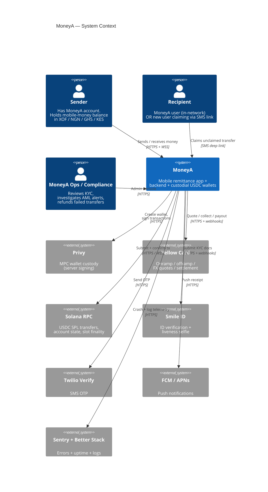
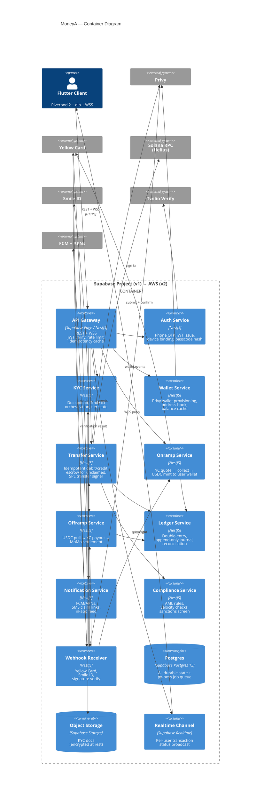
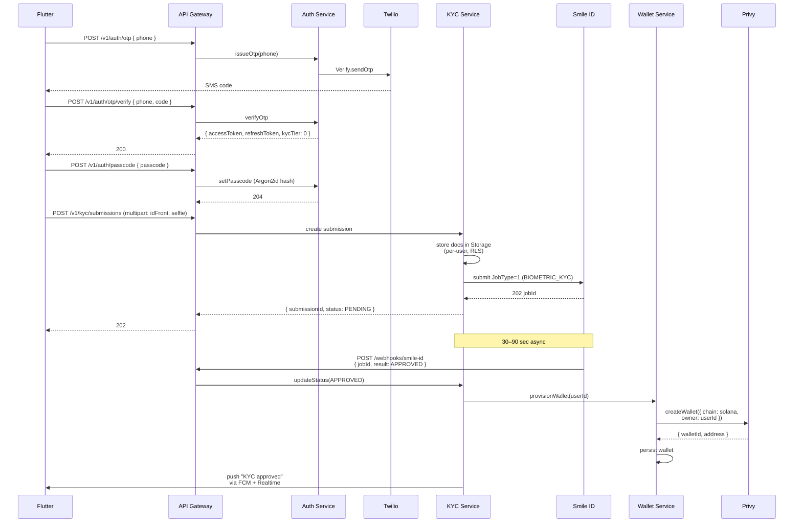
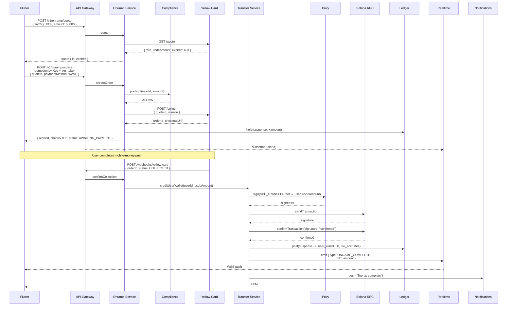
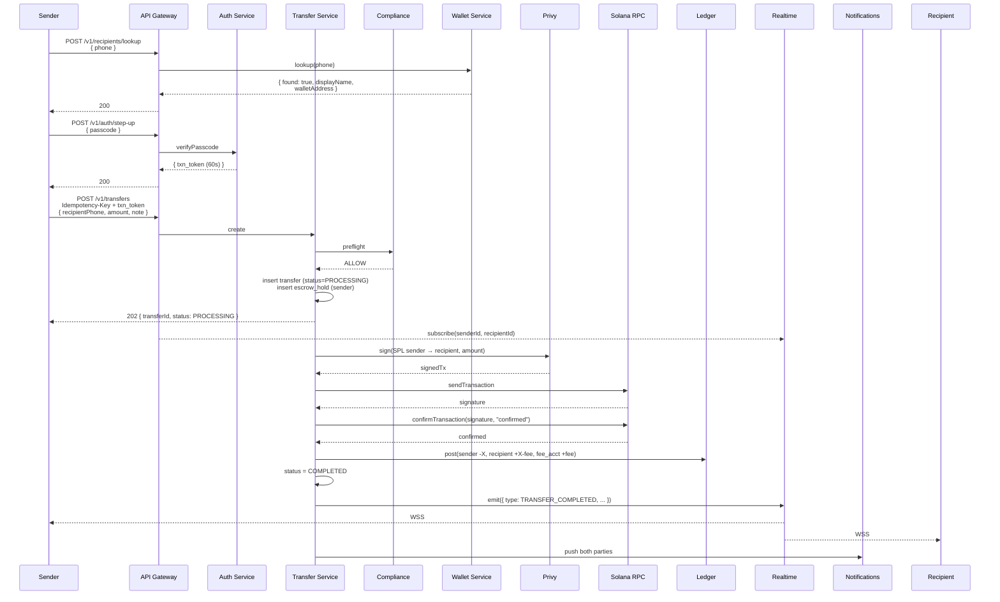
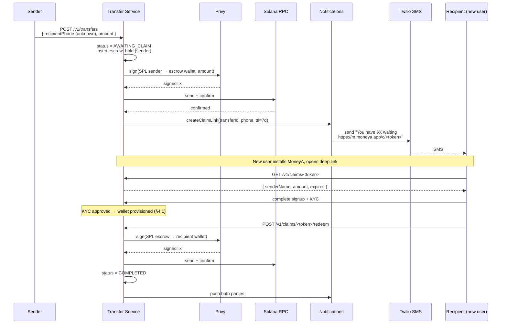

# MoneyA Backend Architecture — v1

**Status:** Specification for backend implementation
**Audience:** Backend engineer building the v1 API
**Last updated:** Phase 1 hand-off

---

## 0. TL;DR

MoneyA v1 is a **custodial Solana-USDC remittance app** for West & Central Africa.
Money flows in via mobile money (Yellow Card → USDC), sits in a custodial Privy
wallet keyed to the user's phone, can be sent in-network to other MoneyA users,
and flows out via mobile money (USDC → Yellow Card → MoMo).

**Tech contract:**

| Concern              | Choice                                                        |
| -------------------- | ------------------------------------------------------------- |
| Cloud (v1 / v2)      | **Supabase** (Postgres + Auth + Storage + Edge) → AWS later   |
| API runtime          | **NestJS + TypeScript** on Supabase Edge Functions / Fly.io   |
| API style            | **REST + JSON, OpenAPI 3.1**, WebSocket for live txn status   |
| Database             | Postgres 15 (Supabase-managed), Row-Level Security ON         |
| Custody              | **Privy** server-managed wallets, Solana                      |
| Chain                | **Solana mainnet** + **USDC SPL** (`EPjFW…TDt1v`)             |
| Onramp / Offramp     | **Yellow Card** (single aggregator across all corridors)      |
| KYC                  | **Smile ID** (pan-African ID + liveness; tier 1)              |
| Phone OTP            | **Twilio Verify** (SMS), fallback **Africa's Talking**        |
| Push                 | **FCM** (Android) + **APNs** (iOS)                            |
| Object storage       | Supabase Storage (KYC docs, encrypted-at-rest)                |
| Secrets              | Supabase Vault → AWS Secrets Manager on migration             |
| Queue / scheduler    | **pg-boss** on Postgres (v1) → SQS + EventBridge (v2)         |
| Observability        | Supabase Logs + Sentry + Better Stack → CloudWatch on AWS     |

**Migration path:** every Supabase-specific dependency below is wrapped behind an
interface (`KvStore`, `BlobStore`, `Queue`, `Auth`) so the AWS cut-over is a
config-and-deploy exercise, not a rewrite.

---

## 1. System Context (C4 Level 1)



---

## 2. Container Diagram (C4 Level 2)



> **Deployment note (v1):** all NestJS services start as **modules within a single
> NestJS monolith** deployed to one container. The "service" boundaries above are
> **module boundaries** — each owns its own folder, DTOs, repository, queue
> consumers — so the cut to separate Fargate services on AWS is a `nest g app`
> away. Don't actually run nine processes on day one.

---

## 3. Per-service responsibilities

Each row is a NestJS **module** in v1, candidate for extraction in v2.

### 3.1 Auth Service

- Phone-OTP issue + verify (Twilio Verify), fallback Africa's Talking
- JWT mint (RS256, 15-min access, 30-day refresh)
- Device binding (`device_id` UUID stored on first login; future logins from a new device require step-up)
- Passcode set / change / verify — **Argon2id** (`m=64 MiB, t=3, p=1`), salt per user, **server-side hash only**
- Biometric is client-only and unlocks the locally-cached refresh token; never bypasses passcode for transactions
- Step-up auth challenge for transactions (returns short-lived `txn_token`, max 60s)
- Owns: `users`, `auth_devices`, `passcode_hashes`, `otp_attempts`

### 3.2 KYC Service

- Tier 0: phone verified only — receive only, ≤ $20/day
- Tier 1: government ID + selfie via Smile ID — full v1 features, ≤ $1000/day
- Tier 2: address proof — deferred to v2
- Document upload → Supabase Storage (per-user folder, RLS enforced) → Smile ID async submission
- Webhook-driven status transitions; emits `kyc.tier_changed` event
- Owns: `kyc_submissions`, `kyc_documents` (metadata only; bytes in Storage)

### 3.3 Wallet Service

- On first KYC tier-1 success: provision Privy server-managed wallet (Solana)
- Persists `wallet_address`, `privy_wallet_id`
- Balance read = Solana RPC `getTokenAccountsByOwner` for the USDC mint, cached 30s
- Address book CRUD (saved recipients by phone)
- Owns: `wallets`, `address_book`

### 3.4 Transfer Service

The hot path. Three flavors:
1. **In-network P2P** (MoneyA → MoneyA): on-chain SPL transfer between two custodial wallets, both managed by Privy. Server holds the only key, so this is effectively an internal book entry **plus** an on-chain settlement for auditability. Sub-second.
2. **Onramp credit** (Yellow Card webhook → user wallet): mint-equivalent (transfer from MoneyA hot wallet) once YC confirms collection.
3. **Offramp debit** (user wallet → MoneyA hot wallet): SPL transfer, then call YC payout API.

Hard rules:
- **Idempotency-Key** required on every write. Stored in `idempotency_keys` table for 24h, key = SHA-256 of (user_id, route, payload).
- **State machine** (single source of truth — see §6): every transfer row holds `status` and `next_action_at` for the resumer worker.
- **FX quote lock**: when offramp involves an FX leg, lock the YC quote for 60s; if signing takes longer, requote.
- **Step-up token** required on submit (max-60s `txn_token` from Auth).
- **Pre-flight** through Compliance Service synchronously; transfer aborts if blocked.

Owns: `transfers`, `transfer_events`, `idempotency_keys`, `escrow_holds`.

### 3.5 Onramp Service

- `POST /v1/onramp/quote` → call YC quote API → cache 60s in `quotes`
- `POST /v1/onramp/orders` → create YC collection request → returns checkout URL (mobile-money push or USSD)
- Yellow Card webhook → `webhook_svc` → `onramp_svc.confirmCollection(orderId)` → trigger Transfer Service to credit wallet
- Owns: `onramp_orders`, `quotes`

### 3.6 Offramp Service

- `POST /v1/offramp/quote` → YC quote
- `POST /v1/offramp/orders` → with `Idempotency-Key`, with `txn_token`:
  1. Compliance pre-flight
  2. Lock quote
  3. Transfer Service signs SPL out of user wallet → MoneyA hot wallet
  4. Call YC payout API with proof of on-chain receipt
  5. Subscribe to YC webhook for settlement
- Refund path: if YC payout fails, Transfer Service reverses the SPL leg back to user's wallet
- Owns: `offramp_orders`

### 3.7 Ledger Service

- **Double-entry, append-only**. Every money-moving operation writes ≥ 2 ledger rows summing to zero.
- Accounts: per-user wallet account, MoneyA hot wallet, Yellow Card receivable, Yellow Card payable, fee account, escrow account, suspense account.
- Daily reconciliation job: ledger total ⇄ on-chain wallet balances ⇄ YC settlement reports. Discrepancy → page on-call.
- Owns: `ledger_accounts`, `ledger_entries` (append-only, no UPDATE).

### 3.8 Notification Service

- FCM / APNs registration tokens per device
- Pub-sub on internal events (`transfer.completed`, `transfer.failed`, `kyc.tier_changed`, `payment_request.received`)
- Templating (i18n for FR/EN), localized digit grouping
- SMS claim links for unclaimed transfers (recipient is a non-MoneyA phone): tokenized, expires 7 days, idempotent
- Owns: `device_tokens`, `notifications`, `claim_links`

### 3.9 Compliance Service

v1 rules (all configurable, hot-reloadable):
- Velocity: max 5 transfers/hour, 20/day, $1000/day per user
- Sanctions screen on every recipient (OFAC, UN, EU lists — refresh nightly)
- Round-number heuristic (multiple identical amounts in 24h → review)
- New-device + first-transfer + amount > $200 → step-up + 1h delay
- Returns `ALLOW`, `REVIEW` (queues for ops), `BLOCK`
- Owns: `compliance_rules`, `compliance_alerts`, `sanctioned_entities`

### 3.10 Webhook Receiver

- Single `/webhooks/:provider` endpoint
- HMAC signature verification per provider (YC: HMAC-SHA256; Smile ID: RSA; Privy: HMAC)
- Idempotent: dedupes on provider event_id
- Stores raw payload in `webhook_events` for replay/audit, then dispatches to owning service
- Replies `200` only after successful enqueue; any handler error → `500` so provider retries

---

## 4. Data flows (sequence diagrams)

### 4.1 First-time onboarding → KYC tier 1 → wallet provision



### 4.2 Onramp: mobile money → USDC



### 4.3 In-network P2P transfer



### 4.4 Unclaimed transfer (recipient is not yet a MoneyA user)



**Expiry rule:** unclaimed > 7 days → scheduled job reverses the SPL leg back to
sender, status = `EXPIRED_REFUNDED`, sender gets a notification.

### 4.5 Offramp: USDC → mobile money

```mermaid
sequenceDiagram
    participant App
    participant Off as Offramp Service
    participant Comp as Compliance
    participant YC as Yellow Card
    participant Trans as Transfer Service
    participant Privy
    participant Sol as Solana RPC
    participant Led as Ledger

    App->>Off: POST /v1/offramp/quote<br/>{ usdcAmount, fiatCcy, msisdn }
    Off->>YC: quote
    YC-->>Off: { rate, fiatAmount, expires }
    Off-->>App: quote

    App->>Off: POST /v1/offramp/orders<br/>Idempotency-Key + txn_token
    Off->>Comp: preflight
    Comp-->>Off: ALLOW
    Off->>Trans: debitUserWallet(userId, usdcAmount)
    Trans->>Privy: sign(SPL user → hot wallet)
    Privy-->>Trans: signedTx
    Trans->>Sol: send + confirm
    Sol-->>Trans: confirmed
    Off->>YC: POST /payout<br/>{ quoteId, msisdn, txProof: signature }
    YC-->>Off: { orderId, status: PROCESSING }
    Off->>Led: post(user -X, suspense +X)
    Off-->>App: { orderId, status: PROCESSING }

    Note over YC: 30s–5min
    YC->>Off: webhook { orderId, status: SETTLED }
    Off->>Led: post(suspense -X, yc_payable +X)
    Off->>App: push "Cash-out complete"
```

---

## 5. Data model (key tables)

```mermaid
erDiagram
    users ||--o{ auth_devices : has
    users ||--|| passcode_hashes : has
    users ||--o{ kyc_submissions : has
    users ||--|| wallets : has
    users ||--o{ transfers : sends
    users ||--o{ transfers : receives
    users ||--o{ onramp_orders : creates
    users ||--o{ offramp_orders : creates
    users ||--o{ device_tokens : registers
    users ||--o{ notifications : receives
    users ||--o{ address_book : owns

    transfers ||--o{ transfer_events : has
    transfers ||--o| escrow_holds : may_have
    transfers ||--o| claim_links : may_have

    onramp_orders ||--|| quotes : uses
    offramp_orders ||--|| quotes : uses

    transfers ||--o{ ledger_entries : posts
    onramp_orders ||--o{ ledger_entries : posts
    offramp_orders ||--o{ ledger_entries : posts

    users {
        uuid id PK
        text phone_e164 UK
        text country_iso2
        text full_name
        kyc_tier_enum kyc_tier
        timestamptz created_at
    }
    wallets {
        uuid user_id PK_FK
        text privy_wallet_id UK
        text address UK
        chain_enum chain
        timestamptz created_at
    }
    transfers {
        uuid id PK
        uuid sender_id FK
        uuid recipient_id FK_nullable
        text recipient_phone
        numeric amount_usdc
        numeric fee_usdc
        transfer_status_enum status
        text idempotency_key UK
        text solana_signature
        timestamptz created_at
        timestamptz next_action_at
    }
    ledger_entries {
        uuid id PK
        uuid account_id FK
        numeric amount
        text currency
        text ref_type
        uuid ref_id
        timestamptz posted_at
    }
```

**Row-Level Security on Supabase:** every user-owned table has a policy
`auth.uid() = user_id`. Service-role key bypasses for backend writes.

---

## 6. Transfer state machine

Single canonical state machine for **all** transfer rows, regardless of flavor:

```
DRAFT ─────────► PROCESSING ─────────► COMPLETED
                     │  ▲                  ▲
                     │  │                  │
                     ▼  │                  │
                AWAITING_CLAIM ────────────┘  (claim redeemed)
                     │
                     │  (7d timeout)
                     ▼
              EXPIRED_REFUNDED
                     ▲
                     │
PROCESSING ──────────┴──► FAILED (signing failed, RPC failed,
                                   YC declined, compliance BLOCK)
```

Persisted on every transition: `transfer_events(transfer_id, from, to, reason, at)`.
A **resumer worker** (pg-boss cron, 30s) finds stuck rows
(`status IN (PROCESSING, AWAITING_CLAIM) AND next_action_at < now()`) and
re-runs the appropriate action — idempotent because each step keys on the
on-chain signature or YC order id.

---

## 7. API surface (sketch)

Full OpenAPI 3.1 spec lives at `docs/backend/openapi.yaml` (to be authored
during implementation). Highlights:

| Method | Path                               | Auth   | Notes                                       |
| ------ | ---------------------------------- | ------ | ------------------------------------------- |
| POST   | `/v1/auth/otp`                     | none   | `{ phone }` → SMS                           |
| POST   | `/v1/auth/otp/verify`              | none   | → access + refresh tokens                   |
| POST   | `/v1/auth/passcode`                | bearer | set / change                                |
| POST   | `/v1/auth/step-up`                 | bearer | `{ passcode }` → `txn_token`                |
| GET    | `/v1/users/me`                     | bearer |                                             |
| POST   | `/v1/kyc/submissions`              | bearer | multipart                                   |
| GET    | `/v1/kyc/status`                   | bearer |                                             |
| GET    | `/v1/wallet`                       | bearer | balance + address                           |
| GET    | `/v1/recipients/lookup?phone=…`    | bearer |                                             |
| POST   | `/v1/onramp/quote`                 | bearer |                                             |
| POST   | `/v1/onramp/orders`                | bearer | Idempotency-Key + txn_token                 |
| POST   | `/v1/offramp/quote`                | bearer |                                             |
| POST   | `/v1/offramp/orders`               | bearer | Idempotency-Key + txn_token                 |
| POST   | `/v1/transfers`                    | bearer | Idempotency-Key + txn_token                 |
| GET    | `/v1/transfers?cursor=…`           | bearer | paginated                                   |
| GET    | `/v1/transfers/:id`                | bearer |                                             |
| POST   | `/v1/payment-requests`             | bearer | Receive → Request                           |
| GET    | `/v1/claims/:token`                | none   | unclaimed-transfer landing                  |
| POST   | `/v1/claims/:token/redeem`         | bearer |                                             |
| POST   | `/v1/devices`                      | bearer | register FCM/APNs token                     |
| GET    | `/v1/notifications`                | bearer |                                             |
| WSS    | `/v1/realtime?token=…`             | bearer | live transfer status                        |
| POST   | `/webhooks/yellow-card`            | hmac   |                                             |
| POST   | `/webhooks/smile-id`               | rsa    |                                             |
| POST   | `/webhooks/privy`                  | hmac   |                                             |

**Conventions enforced by gateway middleware:**
- `Idempotency-Key` is **required** on every state-mutating POST that moves money.
- `txn_token` is **required** on `/v1/transfers`, `/v1/onramp/orders`, `/v1/offramp/orders`. Single-use, max 60s.
- `traceparent` (W3C) propagated through every internal call.
- All money amounts in API are strings (`"12345.67"`) to avoid float precision; backend stores as `numeric(20, 6)`.

---

## 8. Third-party integration matrix

| Provider           | Role                       | Auth                | Failure mode                                  | SLA target           |
| ------------------ | -------------------------- | ------------------- | --------------------------------------------- | -------------------- |
| **Privy**          | Custodial wallets, signing | API key + JWT       | Retry with exp backoff; circuit-breaker → fail txn | 99.9% (Privy SLA)    |
| **Yellow Card**    | Onramp / offramp / FX      | API key + HMAC      | Quote expired → requote; payout failed → reverse SPL | 99.5% (YC SLA)       |
| **Helius (Solana)**| RPC + WebSocket            | API key             | Multi-region fallback (Helius EU + US) + Triton fallback | self-managed         |
| **Smile ID**       | KYC tier-1                 | partner-id + API key| Async; degraded → queue retry; manual review queue | 95% < 2 min          |
| **Twilio Verify**  | SMS OTP                    | account SID + token | Fallback to Africa's Talking on 5xx           | 99.95% (Twilio SLA)  |
| **Africa's Talking** | SMS fallback             | API key             |                                               |                      |
| **FCM / APNs**     | Push                       | service account / p8| Fire-and-forget; no UX dependency             | n/a                  |
| **Sentry**         | Errors                     | DSN                 | Drop on backpressure                          | n/a                  |
| **Better Stack**   | Logs + uptime              | source tokens       | Drop on backpressure                          | n/a                  |
| **Supabase**       | DB + Auth + Storage        | service-role JWT    | Single-region SPOF in v1; AWS migration path  | 99.9% (Supabase SLA) |

**Webhook contract (every provider):**
1. HTTPS only, MoneyA-issued endpoint.
2. Signature header (`X-YC-Signature`, `X-Smile-Signature`, `Privy-Signature`).
3. We reply `200` only after `webhook_events` row inserted **and** queue ack.
4. Provider must retry on non-`2xx` for ≥ 24h with exp backoff.
5. We dedupe on `provider + event_id`.

---

## 9. Security model

The backend implements the controls the **fintech-security skill** requires server-side:

- **Auth**: phone OTP + Argon2id passcode; biometric is client-only.
- **Step-up**: every money move requires a fresh `txn_token`; passcode re-verify on the server, not the client. Replay-protected (single use, 60s, bound to user_id + device_id).
- **Idempotency**: `Idempotency-Key` SHA-256 stored 24h; second submission with same key returns the original response.
- **Rate limiting**: per-IP (gateway), per-user (auth_svc), per-route (transfer_svc). 5 transfers/min/user hard cap.
- **Sanctions screen**: every recipient on every transfer; nightly OFAC/UN/EU list refresh.
- **PII**: phone, name, ID number, address all encrypted at rest (Supabase Vault → AWS KMS envelope on migration). KYC document bytes in Supabase Storage with per-user RLS prefix.
- **Logs**: PII redacted at log call site (`logger.child({ user: redact(user) })`); pre-commit lint forbids `logger.*` with bare `user`, `phone`, `pin`, `passcode`, `card`.
- **Secrets**: Supabase Vault for API keys; rotation playbook for YC, Smile ID, Privy, Twilio quarterly.
- **Network**: backend egress allow-list (only the 10 third parties above).
- **Database**: RLS ON for every table; service-role JWT only used by backend services (never reaches client).
- **Audit**: append-only `audit_log` table for any admin-console action; ledger entries are append-only by trigger.

---

## 10. Observability

Every request is tagged with:
- `trace_id` (W3C traceparent, propagated to Solana RPC + YC + Privy)
- `user_id` (when authed)
- `idempotency_key`
- `transfer_id` / `order_id` (when applicable)

Required dashboards (Better Stack v1 → CloudWatch v2):
- **Money-flow**: onramp $/min, offramp $/min, P2P $/min, by corridor
- **Funnel**: signup → OTP → KYC submitted → KYC approved → first transfer
- **Latency**: p50/p95/p99 of `/v1/transfers` end-to-end (request → COMPLETED)
- **Provider health**: YC quote success rate, Privy signing latency, Solana confirm latency, Smile ID approval time
- **Failure budget**: transfers failed / day, by reason code

Pages on:
- Ledger ⇄ on-chain reconciliation mismatch (any non-zero discrepancy)
- > 5 transfers stuck in PROCESSING for > 5min
- YC webhook backlog > 100
- Privy / Solana RPC error rate > 1% over 5min

---

## 11. Phasing & cut-over to AWS

| Phase | Trigger                 | Migration                                          |
| ----- | ----------------------- | -------------------------------------------------- |
| v1    | Launch                  | Supabase managed (Postgres, Auth, Storage, Edge)   |
| v1.5  | > 10k MAU OR > $1M GMV  | Move heavy services (Transfer, Onramp, Offramp) to Fly.io / Render container; keep Supabase DB |
| v2    | Regulatory or > $5M GMV | Lift-and-shift to AWS af-south-1: RDS, Fargate, SQS, Secrets Manager, CloudWatch, KMS. Postgres logical replication for zero-downtime cut-over. |

Every Supabase-specific call (Storage, Realtime, Auth admin) lives in
`packages/infra-supabase/` behind interfaces in `packages/infra/` —
the AWS implementations slot into `packages/infra-aws/`.

---

## 12. Open decisions for the backend dev

These are explicitly **deferred** and need a call early in implementation:

1. **Hot wallet topology**: single MoneyA hot wallet, or sharded (e.g. one per corridor) for blast-radius? Recommendation: single wallet for v1, shard at v2.
2. **Fee policy**: flat fee, percentage, or tiered? Currently the Flutter UI hard-codes a fee preview from a stub — backend needs a `fee_schedule` table + admin UI.
3. **Refund/dispute UX**: out of scope for v1 backend, but the ledger model must support it without schema change. Confirmed by the design above (ledger entries are append-only; refund = inverse entry).
4. **Voice intent (Phase 2)**: parsing happens client-side per the voice-intent-parsing skill, but a server-side **intent confirmation** endpoint will need to exist before payment to validate the parsed entities against the user's address book + balance.
5. **Cross-corridor send (Phase 2)**: the current quote/order shape already supports a 3-leg trade (XOF → USDC → NGN). Backend should add `legs[]` to quotes from day one to avoid breaking changes.

---

## 13. References

- Custody: `.claude/skills/usdc-stablecoin-ops/SKILL.md`
- Payment rails: `.claude/skills/african-payment-rails/SKILL.md`
- Security: `.claude/skills/fintech-security/SKILL.md`
- Voice (Phase 2): `.claude/skills/voice-intent-parsing/SKILL.md`
- Flutter client architecture: `.claude/skills/flutter-architecture/SKILL.md`
