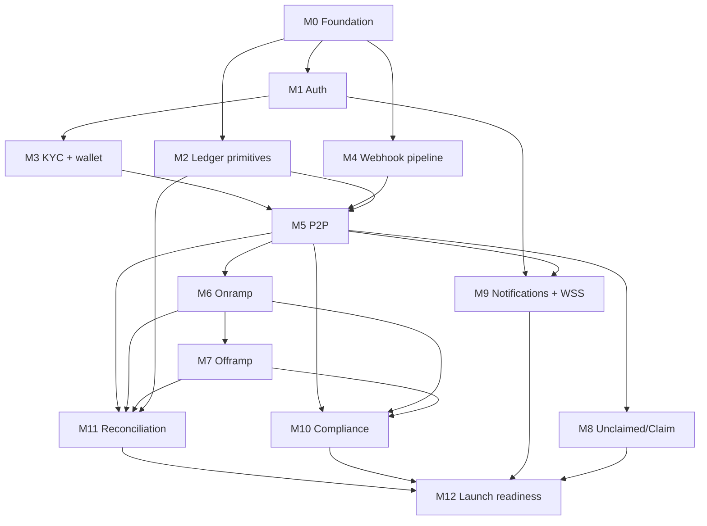

# MoneyA — Phase 1 Backend Backlog

> ⚠️ **Partially superseded.** MoneyA now settles on **Stellar** with **pooled custody**, and the API is **fiat-only** — users must never learn that stablecoins are used. Solana / Privy / SPL parts of this document no longer apply. See [`stellar-mvp-plan.md`](./stellar-mvp-plan.md) §1.1 and **Appendix B** for exactly what changed.

> **Status:** v1
> **Owner:** Backend lead
> **Companion docs:** [`architecture.md`](./architecture.md), [`openapi.yaml`](./openapi.yaml), [`migrations/0001_init.sql`](./migrations/0001_init.sql), [`transfer-state-machine.md`](./transfer-state-machine.md), [`ledger.md`](./ledger.md), [`webhooks.md`](./webhooks.md)

This is the ticketed, sized, sequenced implementation plan to ship MoneyA
Phase 1. Order matters: dependencies are explicit. Tickets are sized in
**ideal-engineer-days (IED)**, with one IED ≈ one focused workday for a
mid-senior backend engineer who has read the spec docs.

**Phase 1 outcome:** end-to-end working flow on Supabase + Privy + Yellow
Card + Smile ID for: signup → OTP → passcode → KYC tier 1 → custodial
Solana wallet → onramp (mobile money → USDC) → in-network P2P → offramp
(USDC → mobile money) → unclaimed-transfer claim links → push
notifications. **Out of scope for Phase 1**: voice intent, merchant
APIs, multi-currency ledger arms, AWS migration, mobile attestation, Argon2id
on-device, FLAG_SECURE.

---

## Table of contents

1. [Sequencing principles](#1-sequencing-principles)
2. [Phase 1 milestones](#2-phase-1-milestones)
3. [Epics & ticket breakdown](#3-epics--ticket-breakdown)
4. [Dependency graph](#4-dependency-graph)
5. [Cross-cutting tickets](#5-cross-cutting-tickets)
6. [Definition of done](#6-definition-of-done)
7. [Sizing summary & timeline](#7-sizing-summary--timeline)
8. [Risk register](#8-risk-register)
9. [Out-of-scope (Phase 2 backlog seed)](#9-out-of-scope-phase-2-backlog-seed)

---

## 1. Sequencing principles

| # | Principle |
|---|-----------|
| S1 | **Vertical slices over horizontal layers.** Each milestone delivers a working user-visible flow end-to-end (DB + service + API + integration test), not "all the DB then all the services." |
| S2 | **Ledger before any movement.** No transfer ticket starts before `0002_state_machine.sql` and the ledger posting helpers are merged. |
| S3 | **Webhooks before async settlement.** The webhook ingestion pipeline (universal handler, dedupe, replay tool) is built before YC integration so YC can be tested end-to-end. |
| S4 | **Auth before everything.** Every other domain assumes a working authenticated request. |
| S5 | **One provider at a time.** Smile → Privy → YC → Twilio in that order. Each is fully integrated and tested before next. |
| S6 | **Parallel-safe seams.** Any worker queue, ledger post, or external call is idempotent from day one. No "we'll add idempotency later." |
| S7 | **Observability shipped with feature, not after.** Each ticket includes its required metrics + tracing as part of DoD. |
| S8 | **Migrations are append-only.** No editing `0001_init.sql`. New schema = new file. |

---

## 2. Phase 1 milestones

| M | Name | Done when… | Approx duration |
|---|------|------------|-----------------|
| **M0** | Foundation | NestJS skeleton, Supabase project, CI green, `0001_init.sql` deployed, smoke-test endpoint up | 4 IED |
| **M1** | Auth & sessions | OTP + passcode + step-up + refresh-token rotation working end-to-end against staging Twilio | 6 IED |
| **M2** | Ledger primitives | `0002_state_machine.sql` deployed, ledger posting helpers merged, transition allowlist enforced, balance functions live | 4 IED |
| **M3** | KYC + wallet provisioning | User can submit ID+selfie, Smile webhook drives APPROVED, Privy wallet auto-provisioned, balance reads work | 7 IED |
| **M4** | Webhook pipeline hardening | Universal handler pipeline, dedupe, replay CLI, per-provider HMAC verification, sandbox-tested for YC + Smile + Privy | 5 IED |
| **M5** | In-network P2P | Recipient lookup, step-up gate, transfer FSM with resumer worker, ledger journals, mirror RECEIVED row, push + WSS | 9 IED |
| **M6** | Onramp | YC quote + order, AWAITING_PAYMENT → COLLECTED → CREDITING_WALLET → COMPLETED, ledger 3-stage, push + WSS | 7 IED |
| **M7** | Offramp | YC quote + order, PROCESSING → SETTLED with refund path on REJECTED, ledger 3-stage incl. batch settlement | 8 IED |
| **M8** | Unclaimed transfers | Claim-link issuance, Twilio SMS, redeem flow, 7-day expiry refund worker, ledger | 6 IED |
| **M9** | Notifications & realtime | FCM/APNs setup, in-app notifications, WSS gateway with auth + heartbeat | 5 IED |
| **M10** | Compliance & limits | Velocity limits per corridor, basic AML preflight, sanctions screening on phone E.164 lookup | 4 IED |
| **M11** | Reconciliation | Daily on-chain + YC + Privy diff job, imbalance views, alerting | 4 IED |
| **M12** | Hardening & launch readiness | Load tests, runbooks, on-call rotation tooling, secret rotation drill, P0 alert wiring | 5 IED |

**Total:** 74 IED. With one engineer @ 1.0 throughput → ~15 calendar
weeks. With two engineers running parallel tracks where deps allow →
~9 calendar weeks. Allow +30% for unknowns, integration friction, code
review → **12-week target with 2 engineers**.

---

## 3. Epics & ticket breakdown

Ticket IDs use the pattern `<EPIC>-<NN>`. Each ticket lists:

- **Size**: IED estimate
- **Deps**: blocking ticket IDs (and external blockers like provider keys)
- **Acceptance**: bullets that must all be true at merge

---

### EPIC FND — Foundation (M0)

#### FND-01 — Bootstrap NestJS monorepo
- **Size:** 1
- **Deps:** none
- **Acceptance:**
  - NestJS app boots locally with `pnpm dev`
  - TypeScript strict mode on
  - ESLint + Prettier configured
  - `pnpm test` runs (zero tests yet, but jest is wired)
  - Folder structure matches `architecture.md` §3 (modules per service)

#### FND-02 — Supabase project & CI/CD
- **Size:** 1
- **Deps:** FND-01
- **Acceptance:**
  - Supabase staging + preview projects provisioned
  - GitHub Actions: lint + test + migration plan on PR; deploy to staging on merge
  - Service role key stored in GitHub Secrets; never in repo
  - Trunk-based: `main` auto-deploys to staging; tag `v*` → prod deploy gated on manual approval

#### FND-03 — Apply `0001_init.sql` to staging
- **Size:** 0.5
- **Deps:** FND-02
- **Acceptance:**
  - `npx supabase db push` clean against fresh staging
  - All 24 tables created, RLS on, seed accounts inserted
  - `app.v_user_balances` view queryable
  - Migration tracking row recorded in `supabase_migrations`

#### FND-04 — Health endpoint + structured logging
- **Size:** 0.5
- **Deps:** FND-01
- **Acceptance:**
  - `GET /healthz` returns 200 with `{ status, version, db: 'up'|'down' }`
  - JSON structured logs (pino) with `traceparent` correlation
  - Sensitive fields redacted (passcode, OTP, raw tokens)

#### FND-05 — OpenTelemetry tracing skeleton
- **Size:** 1
- **Deps:** FND-01
- **Acceptance:**
  - OTel auto-instrumentation for HTTP + pg
  - Local export to console; staging export to Honeycomb (or Grafana Cloud)
  - Span attributes per `webhooks.md` §12.3 conventions
  - `traceparent` propagated to all outbound HTTP

---

### EPIC AUTH — Auth & sessions (M1)

#### AUTH-01 — Twilio Verify integration
- **Size:** 1
- **Deps:** FND-04
- **Acceptance:**
  - `POST /v1/auth/otp { phone }` → Twilio.Verify.sendOtp; returns 202
  - Phone validated as E.164 via `libphonenumber-js`
  - Rate limit: 3 OTPs per phone per hour (in-memory bucket Phase 1)
  - Africa's Talking fallback skeleton in place but not wired (feature flag)

#### AUTH-02 — OTP verify + JWT issuance
- **Size:** 1
- **Deps:** AUTH-01
- **Acceptance:**
  - `POST /v1/auth/otp/verify { phone, code }` → Twilio.Verify.checkOtp
  - On success: insert `app.users` if absent; issue access (15 min) + refresh (30d) JWTs
  - Refresh token persisted hashed in `app.refresh_tokens`
  - Bad code → 401 + increment `app.otp_attempts`; 5 fails in 1h → lockout 15min

#### AUTH-03 — Passcode set + verify (Argon2id)
- **Size:** 1
- **Deps:** AUTH-02
- **Acceptance:**
  - `POST /v1/auth/passcode { passcode }` → Argon2id (m=64MiB, t=3, p=1) → store hash in `app.passcode_hashes`
  - Passcode required before any step-up
  - 6-digit numeric only enforced server-side
  - Constant-time comparison on verify

#### AUTH-04 — Step-up token issuance
- **Size:** 1
- **Deps:** AUTH-03
- **Acceptance:**
  - `POST /v1/auth/step-up { passcode|biometric_assertion }` → 60s `txn_token` bound to `(user_id, device_id)`, single-use
  - Token stored hashed in `app.txn_tokens`
  - Consumed atomically when transfer/onramp/offramp row inserted (`UPDATE ... SET consumed_at = now() WHERE consumed_at IS NULL RETURNING`)
  - Replay → 409 `TXN_TOKEN_CONSUMED`

#### AUTH-05 — Refresh token rotation
- **Size:** 1
- **Deps:** AUTH-02
- **Acceptance:**
  - `POST /v1/auth/refresh { refresh_token }` → issue new access + refresh; old refresh revoked
  - Reuse of revoked refresh → revoke entire family + force re-OTP
  - Family tracking via `app.refresh_tokens.family_id`

#### AUTH-06 — Device registration
- **Size:** 1
- **Deps:** AUTH-02
- **Acceptance:**
  - `POST /v1/devices` registers `(user_id, device_id, kind, push_token)`; idempotent
  - `auth_devices.last_seen_at` updated on every authenticated request via interceptor
  - Inactive devices (> 90d) flagged for cleanup

---

### EPIC LDG — Ledger primitives (M2)

#### LDG-01 — Migration `0002_state_machine.sql`
- **Size:** 1.5
- **Deps:** FND-03
- **Acceptance:**
  - Transition allowlist table + trigger (state-machine.md §10.1)
  - `app.user_available_balance(uuid, text)` function (ledger.md §6.2)
  - `app.posted_journals(journal_id PK, ref_type, ref_id, posted_at)` dedupe table
  - `parent_transfer_id` column on `app.transfers`
  - Per-currency journal validation trigger (L6)
  - `app.v_ledger_imbalance` monitoring view
  - Migration applies cleanly to staging (existing data)

#### LDG-02 — Ledger posting helper module
- **Size:** 1.5
- **Deps:** LDG-01
- **Acceptance:**
  - `LedgerService.postJournal(journalId, entries[], { refType, refId })` writes all entries in one transaction
  - Deterministic `journalId` derivation helper: `uuidv5(NS_LEDGER, key)`
  - Throws on duplicate `journalId` (caught from `app.posted_journals` unique constraint)
  - Throws on currency mismatch within entries
  - Unit tests cover all 7 journal templates from `ledger.md` §4
  - Tracing span `ledger.postJournal` with `journal_id`, `entry_count`, `total_amount` attrs

#### LDG-03 — Ledger query module
- **Size:** 0.5
- **Deps:** LDG-01
- **Acceptance:**
  - `LedgerService.getUserBalance(userId, currency)` reads `app.v_user_balances`
  - `LedgerService.getAvailableBalance(userId, currency)` calls `app.user_available_balance`
  - `LedgerService.getAccountHistory(accountId, { limit, cursor })` cursor-paginated
  - Read-only Supabase client used (separate connection pool)

#### LDG-04 — Ledger reporting views & queries
- **Size:** 0.5
- **Deps:** LDG-01, LDG-02
- **Acceptance:**
  - 4 reporting queries from `ledger.md` §10 implemented as service methods
  - Behind `RequireRole('admin')` guard (admin role to be added in M11; gated for now)

---

### EPIC KYC — KYC + wallet provisioning (M3)

Depends on EPIC WHK (Webhook pipeline) below for the Smile callback.
For sequencing, do `WHK-01..03` *before* `KYC-03`.

#### KYC-01 — Submission endpoint
- **Size:** 1.5
- **Deps:** AUTH-02, FND-03
- **Acceptance:**
  - `POST /v1/kyc/submissions` accepts multipart (id_front, id_back?, selfie)
  - Files stored in Supabase Storage bucket `kyc-docs`, RLS-locked to user
  - Inserts `app.kyc_submissions` row with `status='PENDING'`
  - File size ≤ 5 MB each; MIME whitelist (jpeg/png/heic)
  - Returns `{ submissionId, status: 'PENDING' }`

#### KYC-02 — Smile ID submit
- **Size:** 1.5
- **Deps:** KYC-01
- **Acceptance:**
  - `SmileIdClient.submitJob({ jobType: 1, ...})` called with stable `jobId = 'moneya_kyc_<submissionId>'`
  - Idempotent: re-submit with same jobId returns existing job
  - On 5xx → retry budget per `transfer-state-machine.md` §9.3
  - Failure → mark submission `FAILED`, push notification

#### KYC-03 — Smile webhook handler
- **Size:** 1.5
- **Deps:** WHK-02, KYC-02
- **Acceptance:**
  - Implements webhook handler per `webhooks.md` §6
  - APPROVED → set `kyc_tier=1`, enqueue `provision_wallet` job, push
  - REJECTED → mark rejected with reason, push
  - MANUAL_REVIEW → flag, alert compliance ops, no transition
  - Integration test using fixture replays both APPROVED and REJECTED

#### KYC-04 — Privy wallet provisioning worker
- **Size:** 1.5
- **Deps:** KYC-03
- **Acceptance:**
  - pg-boss worker `provision_wallet` consumes job
  - Calls `PrivyClient.createWallet({ chain: 'solana', owner: userId })` with idempotency key = userId
  - On success: insert `app.wallets`; emit WSS `wallet.created`; push "Wallet ready"
  - On Privy error: pg-boss retry budget (5 attempts, exp backoff); P0 alert if final fail
  - Smoke test against Privy sandbox

#### KYC-05 — KYC status read endpoint
- **Size:** 0.5
- **Deps:** KYC-01
- **Acceptance:**
  - `GET /v1/kyc/status` returns `{ tier, status, rejectionReason?, submittedAt }`
  - 404 if no submission

---

### EPIC WHK — Webhook pipeline (M4)

#### WHK-01 — Universal webhook ingestion controller
- **Size:** 1.5
- **Deps:** FND-04, FND-05
- **Acceptance:**
  - `/webhooks/*` routes use `express.raw({ type: 'application/json' })` middleware (§2.1)
  - 8-step pipeline implemented as `WebhookIngestService.ingest(provider, raw, headers)`
  - 200 returned after audit-row insert + queue enqueue
  - Returns 400 on bad signature, 413 on > 512KB, 500 on DB failure
  - Per-provider strategy pattern for verification

#### WHK-02 — Signature verifiers
- **Size:** 1
- **Deps:** WHK-01
- **Acceptance:**
  - `YcVerifier`, `SmileVerifier`, `PrivyVerifier` classes per `webhooks.md` §3
  - Constant-time comparison via `crypto.timingSafeEqual`
  - YC verifier rejects timestamps drifting > 5 min
  - Smile verifier uses RFC 8785 JCS canonicalisation
  - Unit tests with fixtures (good + bad signatures)

#### WHK-03 — Dedupe & worker dispatch
- **Size:** 1
- **Deps:** WHK-01, FND-03
- **Acceptance:**
  - `INSERT ... ON CONFLICT DO NOTHING RETURNING id` on `audit.webhook_events`
  - On conflict: return 200, don't enqueue
  - On insert: enqueue `webhook_processing` job with raw payload + provider
  - Worker dispatches to per-provider handler service
  - Per-(provider, ref_id) advisory lock in worker (`webhooks.md` §4.6)

#### WHK-04 — Replay CLI + DLQ monitoring
- **Size:** 1
- **Deps:** WHK-03
- **Acceptance:**
  - `moneya-ops webhook replay <provider> <event_id> [--dry-run]`
  - Replays via re-enqueue; dry-run logs intended transitions + ledger journals
  - DLQ inspector: `moneya-ops webhook dlq list|reprocess|drop <id>`
  - Daily cron alert on rows older than 1h with `processing_error` set, `processed_at` null
  - Audit log entry on every replay

#### WHK-05 — Privy webhook handler
- **Size:** 0.5
- **Deps:** WHK-03
- **Acceptance:**
  - Handles `wallet.created` (idempotent), `wallet.transaction_signed` (audit only), `wallet.policy_violation` (P0 alert + suspend wallet)
  - `audit.privy_signings` table seeded by handler
  - Test fixtures for all 3 events

---

### EPIC P2P — In-network P2P transfer (M5)

#### P2P-01 — Recipient lookup
- **Size:** 1
- **Deps:** AUTH-02, KYC-04
- **Acceptance:**
  - `GET /v1/recipients/lookup?phone=+221...` validates E.164
  - Looks up by `users.phone_e164` (citext); requires recipient `kyc_tier >= 1`
  - Returns `{ found: true, displayName, walletAddress }` or `{ found: false }`
  - Rate limit: 30 lookups / user / minute (anti-enumeration)
  - Phone hashed in audit log, not raw

#### P2P-02 — Saved recipients (address book)
- **Size:** 0.5
- **Deps:** P2P-01
- **Acceptance:**
  - `GET /v1/recipients/saved` returns user's `app.address_book` entries
  - `POST /v1/recipients/saved` adds; `DELETE /v1/recipients/saved/:id`
  - Unique on `(user_id, phone)`

#### P2P-03 — Idempotency middleware
- **Size:** 1
- **Deps:** AUTH-04
- **Acceptance:**
  - Enforces `Idempotency-Key` header per `transfer-state-machine.md` §9.1 on transfer/onramp/offramp create routes
  - Uses `app.idempotency_keys` table
  - 24h replay window
  - Same-hash replay returns cached response; different hash → 409
  - In-flight (partial) → 409 `REQUEST_IN_FLIGHT`

#### P2P-04 — Transfer create endpoint
- **Size:** 1.5
- **Deps:** P2P-01, P2P-03, AUTH-04, LDG-02
- **Acceptance:**
  - `POST /v1/transfers` validates per state-machine.md §4.2
  - Atomic `DRAFT → PROCESSING` with escrow hold under SERIALIZABLE (§4.3)
  - Compliance preflight stub (real implementation in M10)
  - Returns 202 `{ transferId, status: 'PROCESSING' }`
  - Negative cases: insufficient funds → 422; self-transfer → 400; recipient unknown → routes to claim-link path (M8 dependency, stubbed for now)

#### P2P-05 — Privy signing client
- **Size:** 1
- **Deps:** KYC-04
- **Acceptance:**
  - `PrivyClient.signSplTransfer({ from, to, amount, idempotencyKey })`
  - Idempotency key = `transfer.id`; Privy server-side dedupes
  - Retry budget per state-machine.md §9.3 (5 attempts / 30s)
  - Returns signed-tx blob + signature
  - Tracing span includes Privy request_id for forensics

#### P2P-06 — Solana submission worker
- **Size:** 1.5
- **Deps:** P2P-05
- **Acceptance:**
  - Worker `transfer_submit` consumes from queue
  - `solana.sendTransaction` with primary RPC (Helius), fallback (QuickNode)
  - `confirmTransaction(sig, "confirmed")` with 60s timeout
  - On confirm → atomic `PROCESSING → COMPLETED` per state-machine.md §4.4
  - Posts P2P journal per ledger.md §4.1
  - Inserts mirror RECEIVED row
  - Emits WSS to both parties (M9 dep stubbed)
  - Failure → state-machine.md §4.5 path

#### P2P-07 — Resumer worker
- **Size:** 1.5
- **Deps:** P2P-06
- **Acceptance:**
  - pg-boss cron every 30s
  - Picks up rows per state-machine.md §8.1 query (uses `FOR UPDATE SKIP LOCKED`)
  - Per-row dispatch logic per §8.2 pseudocode
  - Polls `getSignatureStatuses` on multi-RPC quorum before declaring failure
  - `retry_count` incremented; > 5 → quarantine + P1 alert
  - Unit tests for each branch (DRAFT TTL, PROCESSING with sig, PROCESSING without sig, AWAITING_CLAIM expiry)

#### P2P-08 — Transfer read endpoints
- **Size:** 0.5
- **Deps:** P2P-04
- **Acceptance:**
  - `GET /v1/transfers?cursor&limit&kind` cursor-paginated, sorted desc by `created_at`
  - `GET /v1/transfers/:id` returns full detail incl. `transfer_events` history
  - RLS ensures only sender/recipient can read
  - Sensitive fields (other party PII) gated by KYC tier

#### P2P-09 — Cancel endpoint
- **Size:** 0.5
- **Deps:** P2P-04
- **Acceptance:**
  - `DELETE /v1/transfers/:id` allowed only for `DRAFT` (immediate cancel) or `AWAITING_CLAIM` (refund flow); deferred to M8 for AWAITING_CLAIM
  - 4xx on any other status

---

### EPIC ON — Onramp (M6)

#### ON-01 — YC client + quote endpoint
- **Size:** 1
- **Deps:** WHK-02 (HMAC patterns shared), AUTH-02
- **Acceptance:**
  - `YcClient.quote({ fiatCcy, amount, paymentMethod })`
  - `POST /v1/onramp/quote` exposes; persists `app.quotes` row, 60s TTL
  - Returns `{ quoteId, rate, usdcAmount, expires }`
  - 5xx retry per state-machine.md §9.3

#### ON-02 — Onramp order create
- **Size:** 1.5
- **Deps:** ON-01, P2P-03, AUTH-04
- **Acceptance:**
  - `POST /v1/onramp/orders` validates quote not expired
  - Compliance preflight (stub OK)
  - Calls `YcClient.collect({ quoteId, msisdn })`; persists `app.onramp_orders`
  - SUSPENSE pre-hold concept (no ledger entry per ledger.md §4.2.1; tracked logically)
  - Returns `{ orderId, checkoutUrl, status: 'AWAITING_PAYMENT' }`
  - 30-min `next_action_at`

#### ON-03 — YC webhook handler
- **Size:** 1.5
- **Deps:** WHK-03, ON-02, LDG-02
- **Acceptance:**
  - Per `webhooks.md` §5
  - `collection.completed` → drives `AWAITING_PAYMENT → COLLECTED`; sets `next_action_at = now()`
  - `collection.failed` → drives `AWAITING_PAYMENT → FAILED` (PROVIDER_REJECTED)
  - Amount tolerance check (0.01 fiat); mismatch → manual review
  - Race-handling: 5s lookup retry on missing order

#### ON-04 — USDC credit worker
- **Size:** 1.5
- **Deps:** ON-03, P2P-05, P2P-06
- **Acceptance:**
  - Worker picks up `COLLECTED` orders
  - Drives `COLLECTED → CREDITING_WALLET`
  - Calls `PrivyClient.signSplTransfer(hot → user)`; submits + confirms
  - On confirm → `CREDITING_WALLET → COMPLETED`
  - Posts 2 ledger journals per ledger.md §4.2.3 (clear receivable + credit)
  - On RPC budget exhaustion in `COLLECTED` → P1 alert; row stays in CREDITING_WALLET (never auto-FAIL); see state-machine.md §11.5
  - Push "Top-up complete" via M9

#### ON-05 — Onramp expiry worker
- **Size:** 0.5
- **Deps:** ON-02
- **Acceptance:**
  - Resumer flips `AWAITING_PAYMENT` rows past 30min to `EXPIRED`
  - YC.cancelOrder called (best-effort)

---

### EPIC OFF — Offramp (M7)

#### OFF-01 — Offramp quote endpoint
- **Size:** 1
- **Deps:** ON-01 (YC client reuse)
- **Acceptance:**
  - `POST /v1/offramp/quote { usdcAmount, fiatCcy, msisdn }`
  - YC quote with same 60s TTL
  - Persists `app.quotes` row; returns standardised quote shape

#### OFF-02 — Offramp order create + Solana debit
- **Size:** 2
- **Deps:** OFF-01, P2P-03, P2P-05, P2P-06, LDG-02
- **Acceptance:**
  - `POST /v1/offramp/orders` validates quote, balance, KYC
  - Atomic insert with escrow hold (sender side)
  - Enqueues `offramp_debit` worker
  - Worker: Privy.sign(SPL user → hot), submit, confirm
  - On confirm: post journal A (ledger.md §4.3.1)
  - Calls `YcClient.payout({ quoteId, msisdn, txProof: signature })`
  - On YC ack: post journal A.5 + Z (pledge + fee capture)
  - Returns `{ orderId, status: 'PROCESSING' }`

#### OFF-03 — Offramp webhook + settlement
- **Size:** 1.5
- **Deps:** OFF-02, WHK-03
- **Acceptance:**
  - `payout.settled` → drives `PROCESSING → SETTLED`; posts journal B (per-order YC_PAYABLE → SUSPENSE)
  - Push "Cash-out complete"
  - Strict ordering: SETTLED only valid after we've persisted `yc_order_id`

#### OFF-04 — Offramp failure & refund
- **Size:** 1.5
- **Deps:** OFF-03
- **Acceptance:**
  - `payout.failed` → drives `PROCESSING → FAILED`
  - Refund worker: Privy.sign(SPL hot → user); on confirm → `FAILED → REFUNDED`
  - Posts journals R1 + R2 + R3 (ledger.md §4.3.4)
  - Push "Cash-out failed; funds returned"

#### OFF-05 — YC batch settlement reconciler
- **Size:** 1
- **Deps:** OFF-03
- **Acceptance:**
  - Daily ops job consumes YC settlement CSV (SFTP)
  - Posts SUSPENSE → HOT_WALLET journal per ledger.md §4.3.3 stage C
  - Reconciles per-order entries against batch total; mismatch → P1 alert
  - Behind admin role; manual trigger + scheduled at 03:00 UTC

#### OFF-06 — YC bug guard: settled-after-failed
- **Size:** 0.5
- **Deps:** OFF-04
- **Acceptance:**
  - Detect terminal-state-locked transition rejection on `payout.settled`
  - P1 alert with audit context (sandbox YC bug noted in webhooks.md §5.3)

---

### EPIC CLM — Unclaimed transfers & claim links (M8)

#### CLM-01 — Claim-link issuance on PROCESSING (recipient unknown)
- **Size:** 1.5
- **Deps:** P2P-04, P2P-06
- **Acceptance:**
  - When `recipient_id IS NULL AND recipient_phone IS NOT NULL`, P2P-06 worker signs SPL sender → escrow_wallet (instead of recipient_wallet)
  - On confirm → drives `PROCESSING → AWAITING_CLAIM`
  - Inserts `app.claim_links` row, TTL 7d, token hashed
  - Posts journal per ledger.md §4.4.1

#### CLM-02 — Twilio SMS claim link
- **Size:** 1
- **Deps:** CLM-01, AUTH-01 (Twilio client reuse)
- **Acceptance:**
  - SMS body: localised (FR/EN based on country code), w/ link `https://m.moneya.app/c/<token>`
  - Send via pg-boss job (5 retries / 1h)
  - Failure → audit but do NOT alert sender (claim still valid; can manually re-notify)

#### CLM-03 — Claim metadata read
- **Size:** 0.5
- **Deps:** CLM-01
- **Acceptance:**
  - `GET /v1/claims/:token` returns `{ senderName, amount, currency, expires }` if PENDING
  - 404 on expired/redeemed/cancelled (no info leak)

#### CLM-04 — Redeem endpoint
- **Size:** 1.5
- **Deps:** CLM-03, KYC-04, P2P-05, P2P-06
- **Acceptance:**
  - `POST /v1/claims/:token/redeem` requires recipient KYC ≥ 1
  - Phone-match check (KYC phone == claim phone); mismatch → 403, no leak
  - Atomic: claim_links → REDEEMED; transfers → marks `recipient_id`, `next_action_at = now()`
  - Worker signs SPL escrow → recipient_wallet; on confirm → `AWAITING_CLAIM → COMPLETED`; mirror RECEIVED row
  - Posts journal per ledger.md §4.4.2

#### CLM-05 — 7-day expiry refund worker
- **Size:** 1
- **Deps:** CLM-01
- **Acceptance:**
  - Cron every 60s queries pending claims past `expires_at`
  - Enqueues refund: SPL escrow → sender_wallet, full amount + fee
  - On confirm → `claim_links.EXPIRED`, `transfers.EXPIRED_REFUNDED`
  - Posts journal per ledger.md §4.4.3
  - Push "Unclaimed transfer returned"

#### CLM-06 — Sender cancel of AWAITING_CLAIM
- **Size:** 0.5
- **Deps:** CLM-05, P2P-09
- **Acceptance:**
  - `DELETE /v1/transfers/:id` allowed when `AWAITING_CLAIM`
  - Same refund path as CLM-05 but end-state `CANCELLED`
  - Push "Transfer cancelled; funds returned"

---

### EPIC NOT — Notifications & realtime (M9)

#### NOT-01 — FCM + APNs setup
- **Size:** 1
- **Deps:** AUTH-06
- **Acceptance:**
  - Firebase project provisioned; FCM service account key in Vault
  - APNs auth key uploaded
  - `PushService.send(userId, { title, body, deepLink, kind })` fans out to all active devices
  - Failure handling: `revoked`/`not registered` → mark `device_tokens.revoked_at`
  - Test sends from staging

#### NOT-02 — In-app notifications
- **Size:** 1
- **Deps:** AUTH-02
- **Acceptance:**
  - `POST /v1/notifications` (internal) inserts `app.notifications` row
  - `GET /v1/notifications?cursor&limit` lists (RLS-filtered)
  - `POST /v1/notifications/read` marks read (single or bulk)
  - Per-kind enum mapping for icon/route on client (deep link convention)

#### NOT-03 — WSS gateway
- **Size:** 1.5
- **Deps:** AUTH-02
- **Acceptance:**
  - `/v1/realtime?token=<access>` upgrade to WSS
  - Auth via query param (per OpenAPI §1079)
  - Heartbeat: server ping 25s, client pong 10s timeout
  - Server emits `RealtimeEvent` JSON frames per OpenAPI schema
  - Auto-subscribed channels: transfer.*, onramp.*, offramp.*, kyc.*, notification.*
  - Backed by Redis pub-sub (Phase 1) for multi-instance fan-out

#### NOT-04 — Wire all transfer/onramp/offramp completions
- **Size:** 1.5
- **Deps:** NOT-01, NOT-02, NOT-03, P2P-06, ON-04, OFF-03
- **Acceptance:**
  - Every state-machine.md terminal transition emits both push + WSS + in-app notification (where appropriate per kind)
  - Notification kind mapping table documented; enum exhaustively covered
  - Integration tests assert all three channels fire

---

### EPIC CMP — Compliance & limits (M10)

#### CMP-01 — Velocity limits
- **Size:** 1
- **Deps:** P2P-04, ON-02, OFF-02
- **Acceptance:**
  - Pre-condition check on transfer/onramp/offramp create
  - Phase 1 thresholds: $1000/txn, $5000/day, $20000/month for KYC tier 1
  - Implemented as SQL aggregation on `app.transfers` + `onramp_orders` + `offramp_orders` (last 24h, 30d windows)
  - Exceeded → 422 `VELOCITY_LIMIT`

#### CMP-02 — Sanctions screening
- **Size:** 1.5
- **Deps:** P2P-01, KYC-03
- **Acceptance:**
  - On every recipient lookup AND on KYC approval, check `app.sanctioned_entities` table (seeded from OFAC SDN + EU + UN lists, refreshed weekly)
  - Match → block transfer, alert compliance ops via `app.compliance_alerts`
  - Fuzzy match on name (pg_trgm) + exact on phone E.164

#### CMP-03 — AML preflight stub → real
- **Size:** 1
- **Deps:** P2P-04, ON-02, OFF-02
- **Acceptance:**
  - Replace stub `compliance.preflight()` with real check: velocity + sanctions + structuring (3+ transfers same recipient same day)
  - Returns `ALLOW | REVIEW | BLOCK`
  - REVIEW at Phase 1 = ALLOW + flag (per state-machine.md decision)
  - BLOCK → DRAFT → FAILED with COMPLIANCE_BLOCK; generic user message

#### CMP-04 — Compliance alerts dashboard read
- **Size:** 0.5
- **Deps:** CMP-02, CMP-03
- **Acceptance:**
  - `GET /v1/admin/compliance/alerts` lists `compliance_alerts` rows (admin only)
  - Mark resolved endpoint
  - Audit logged

---

### EPIC REC — Reconciliation (M11)

#### REC-01 — On-chain balance reconciler
- **Size:** 1.5
- **Deps:** LDG-04, KYC-04
- **Acceptance:**
  - Daily 02:00 UTC job
  - Pulls Solana on-chain USDC balance for every wallet (USER_WALLET, hot, escrow)
  - Diffs against `app.v_user_balances`
  - Writes results to `audit.reconciliation_runs` (table created by REC-04)
  - Tolerance: 0 USDC; non-zero → P1 alert

#### REC-02 — YC settlement diff
- **Size:** 1
- **Deps:** OFF-05
- **Acceptance:**
  - Same daily job consumes YC's daily report (already done by OFF-05)
  - Compare `YC_RECEIVABLE` ledger delta vs report's collected total
  - Compare `YC_PAYABLE` ledger delta vs report's paid total
  - Tolerance 0.1 USDC; exceed → P1 + ticket

#### REC-03 — Privy attestation diff
- **Size:** 1
- **Deps:** REC-01
- **Acceptance:**
  - Pull Privy `GET /v1/wallets/:id/balance` for every USER_WALLET
  - Compare ledger vs Privy attested
  - Mismatch → P0 alert (rare; indicates Privy or our drift)

#### REC-04 — Reconciliation migration & dashboard
- **Size:** 0.5
- **Deps:** REC-01
- **Acceptance:**
  - `0003_reconciliation.sql` adds `audit.reconciliation_runs` table
  - Admin endpoint to fetch runs + drill into deltas
  - Imbalance view (`app.v_ledger_imbalance`) wired to dashboard

---

### EPIC LCH — Hardening & launch readiness (M12)

#### LCH-01 — Load test plan
- **Size:** 1
- **Deps:** all features
- **Acceptance:**
  - k6 scenarios: signup, OTP, transfer, onramp, offramp, claim
  - Targets: 100 RPS sustained, p99 < 500ms on read endpoints, p99 < 2s on transfer create
  - Run against staging; tune connection pools + worker concurrency
  - Report attached to launch ticket

#### LCH-02 — Runbooks
- **Size:** 1.5
- **Deps:** all features
- **Acceptance:**
  - Per-alert runbook: P0 wallet.policy_violation, P0 ledger imbalance, P1 onramp stuck COLLECTED, P1 webhook DLQ growing, P0 Privy gas wallet empty, etc.
  - Runbooks live in `docs/runbooks/<alert-name>.md`
  - Each: detection, immediate mitigation, root cause investigation, remediation, post-mortem template
  - Linked from alert payloads

#### LCH-03 — Secret rotation drill
- **Size:** 0.5
- **Deps:** WHK-02
- **Acceptance:**
  - Execute dual-acceptance secret rotation (webhooks.md §11.2) for `YC_WEBHOOK_SECRET` against sandbox
  - Document elapsed time + any friction
  - Schedule 90-day rotation reminder

#### LCH-04 — On-call rotation tooling
- **Size:** 0.5
- **Deps:** LCH-02
- **Acceptance:**
  - PagerDuty service + escalation policy configured
  - All P0/P1 alerts routed appropriately
  - Engineer schedule populated (or interim solo schedule)

#### LCH-05 — Pre-launch security review
- **Size:** 1
- **Deps:** all features
- **Acceptance:**
  - External pen-test or internal review against OWASP API Top 10
  - All criticals fixed; highs triaged with explicit accept/fix decision
  - Idempotency replay attack test included
  - JWT key rotation plan in place

#### LCH-06 — Launch checklist
- **Size:** 0.5
- **Deps:** LCH-01..05
- **Acceptance:**
  - Production secrets populated
  - DNS + TLS verified
  - Webhook URLs registered with all 3 providers (production, not sandbox)
  - Phone numbers (Twilio production) provisioned per corridor
  - Privy production org configured
  - Staged rollout plan: country-by-country (Senegal first, then CIV/TG/ML, then NG/GH/KE)

---

## 4. Dependency graph

Critical path (longest): M0 → M2 → M5 → M6 → M7 → M11 → M12. Anything
parallel-able is fair game for the second engineer (M3 + M4 + M9 are
prime candidates for parallel work).

---

## 5. Cross-cutting tickets

These don't fit neatly into one epic but must be addressed.

| ID | Description | Size | Suggested timing |
|----|-------------|------|------------------|
| X-01 | Error taxonomy + RFC 7807 Problem responses across all endpoints | 1 | M0 (apply pattern) + revisit each milestone |
| X-02 | Rate limiting (Redis token bucket) on all public endpoints | 1 | M1 |
| X-03 | Phone number normalisation utility (libphonenumber-js wrapper) | 0.5 | M1 |
| X-04 | Money formatting utility (server-side mirror of `MoneyFormat`) | 0.5 | M2 |
| X-05 | i18n strings for SMS, push, email (FR + EN, then add WO/BM/LIN/PIDGIN per skill) | 1 | M3 (KYC SMS) onwards |
| X-06 | Audit log writer middleware on all admin + sensitive endpoints | 0.5 | M11 |
| X-07 | API versioning strategy doc (`/v1/` baked in; migration plan if `/v2/` ever needed) | 0.5 | M0 |
| X-08 | DB connection pool sizing + PgBouncer (Supabase) tuning | 0.5 | M12 |
| X-09 | Secret-management bootstrap (Supabase Vault → AWS Secrets Manager when migrated) | 0.5 | M0 |

Total cross-cutting: **6 IED**.

---

## 6. Definition of done

For every ticket, "done" means **all** of:

- ✅ Code merged to `main` via PR with at least 1 approval
- ✅ Unit tests cover happy path + each documented failure mode
- ✅ Integration test exists for any external boundary (DB, queue, HTTP)
- ✅ OpenAPI spec updated if the API surface changed
- ✅ Migration applies clean against staging (if schema change)
- ✅ Required metrics emitted (per-feature list in spec docs)
- ✅ Tracing spans added for every external call
- ✅ Logs structured + PII-redacted
- ✅ Required alerts wired (per-feature list in spec docs)
- ✅ Runbook entry exists for any new alert
- ✅ Acceptance criteria from this doc verified in PR description
- ✅ Demo-able to product in staging

A ticket is **not done** until deployed to staging and exercised once.

---

## 7. Sizing summary & timeline

| Epic | IED |
|------|-----|
| FND | 4.0 |
| AUTH | 6.0 |
| LDG | 4.0 |
| KYC | 6.5 |
| WHK | 5.0 |
| P2P | 9.0 |
| ON | 6.5 |
| OFF | 7.5 |
| CLM | 5.5 |
| NOT | 5.0 |
| CMP | 4.0 |
| REC | 4.0 |
| LCH | 5.0 |
| **Cross-cutting** | **6.0** |
| **TOTAL** | **78.0 IED** |

(Slightly higher than M0..M12 milestone sums because cross-cutting was
not double-counted in milestones.)

### 7.1 Timeline scenarios

| Scenario | Engineers | Throughput | Calendar weeks |
|----------|-----------|------------|-----------------|
| Solo founder-eng | 1 | 0.8 (context-switching tax) | ~20 weeks |
| Two-engineer team | 2 | 1.6 | ~10 weeks |
| Two-engineer team + 30% buffer | 2 | 1.6 | ~13 weeks |
| Three-engineer team + 30% buffer | 3 | 2.2 | ~9 weeks |

**Recommended target: 2 engineers, 12 weeks to staging-complete, +2 weeks
hardening = 14 weeks to production launch.**

### 7.2 Suggested sprint breakdown (2-engineer team, 2-week sprints)

| Sprint | Eng A focus | Eng B focus |
|--------|-------------|-------------|
| 1 | FND + AUTH-01..03 | FND review + AUTH-04..06 |
| 2 | LDG-01..04 | WHK-01..03 |
| 3 | KYC-01..05 | WHK-04..05, NOT-01..02 |
| 4 | P2P-01..04 | NOT-03..04 |
| 5 | P2P-05..07 | ON-01..02 |
| 6 | P2P-08..09, ON-03..05 | OFF-01..02 |
| 7 | OFF-03..06 | CLM-01..03 |
| 8 | CLM-04..06 | CMP-01..03 |
| 9 | REC-01..04 | CMP-04 + LCH-01 (load test) |
| 10 | LCH-02..03 (runbooks, rotation drill) | LCH-04..06 (security, launch checklist) |

Sprints 11–13 reserved for bug-fix carry-over, integration friction,
real-environment surprises (Privy/YC quirks discovered only in prod
sandbox at scale).

---

## 8. Risk register

| ID | Risk | Likelihood | Impact | Mitigation |
|----|------|------------|--------|------------|
| R1 | Yellow Card sandbox doesn't match production behaviour (we've already seen `payout.settled` after `payout.failed` in sandbox) | High | Medium | OFF-06 guard; early prod sandbox testing; have YC technical contact on call |
| R2 | Privy MPC custody outage during a transfer | Medium | High | Resumer worker holds rows in PROCESSING; P0 alert on gas wallet empty; contractual SLA review |
| R3 | Solana RPC instability (Helius issues) causing confirmation delays | Medium | Medium | Multi-RPC quorum (Helius + QuickNode); 150s blockhash safety window |
| R4 | Smile ID rejection rates higher than expected (selfie quality) | Medium | High (UX) | Phase 1 = manual review safety net; CMP-04 dashboard; document common rejection reasons |
| R5 | Twilio SMS delivery in target corridors patchy (esp. Senegal MNOs) | Medium | Medium | Africa's Talking fallback in AUTH-01 (skeleton ready, wire on first incident) |
| R6 | Ledger drift before reconciliation catches it | Low | High | Imbalance monitoring view + nightly recon; rapid-response runbook |
| R7 | Secret leak via misconfigured logs | Low | Critical | Redaction middleware + structured logs review in code review checklist |
| R8 | RLS policy gap leaks user A's data to user B | Low | Critical | Pre-launch pen-test (LCH-05) explicitly covers RLS; integration tests assert RLS for every table |
| R9 | Webhook secret rotation breaks production (cutover gap) | Low | High | Dual-acceptance pattern (webhooks.md §11.2); LCH-03 drill |
| R10 | Phase 2 architecture (AWS migration) blocks Phase 1 launch | Low | Medium | Phase 1 deliberately scoped to Supabase-only; AWS migration is a Phase 2 epic |
| R11 | OFAC/EU/UN sanctions list freshness | Medium | Critical (regulator) | Weekly refresh job; CMP-02 covers; manual override path documented |
| R12 | Privy gas wallet runs dry at 3am | Low | High | P0 alert at < 0.5 SOL; auto-top-up Lambda at < 0.2 SOL (Phase 2; manual at Phase 1) |

---

## 9. Out-of-scope (Phase 2 backlog seed)

Captured here so they aren't lost; not for Phase 1.

- Multi-currency ledger arms (XOF/NGN/GHS direct)
- Per-corridor hot-wallet sharding
- Cold storage sweep automation
- Merchant outbound webhooks + dashboard
- Voice intent capture + LLM function-calling parser
- Africa's Talking SMS provider live (currently skeleton only)
- Mobile attestation (Play Integrity, App Attest)
- Argon2id passcode hashing on-device (currently server-side only)
- FLAG_SECURE on Android transfer screens
- Time-partitioning of `ledger_entries` and `audit.audit_log`
- AWS af-south-1 migration (Fargate, RDS, ALB, Secrets Manager)
- Active-active multi-region
- Per-service breakout (currently NestJS modules in monolith)
- BCEAO / CBN regulatory reporting automation
- Customer support tooling (transaction lookup, manual reconciliation UI, refund authorisation)
- Address book sync from device contacts (server-side echo)
- Receipt PDF export server-side (currently mobile-only)
- Push notification rich content (action buttons)
- WebAuthn / FIDO2 for high-value transfers

---

**End of backlog.** Hand-off bundle complete:

| Doc | Purpose | Lines |
|-----|---------|-------|
| `architecture.md` | C4 + data flows + module split | 711 |
| `openapi.yaml` | Wire contract for 23 endpoints + 3 webhooks + WSS | 1892 |
| `migrations/0001_init.sql` | Supabase Postgres init | 843 |
| `transfer-state-machine.md` | FSM, transitions, resumer, edge cases | 902 |
| `ledger.md` | Account taxonomy + per-flow journal templates | 837 |
| `webhooks.md` | Inbound webhook contracts per provider | 808 |
| `backlog.md` | Phase 1 ticketed plan, this doc | 600+ |

Total: ~6600 lines of authoritative spec. A backend engineer reading
these in order can implement Phase 1 without further design input.
