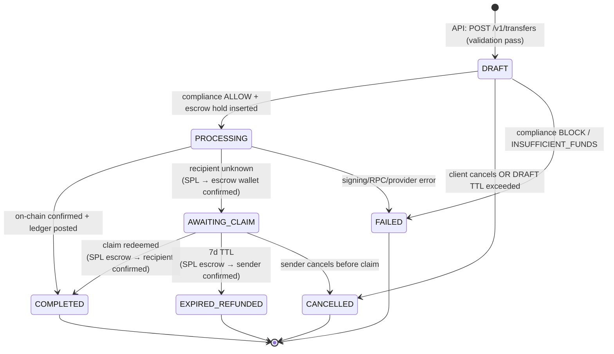
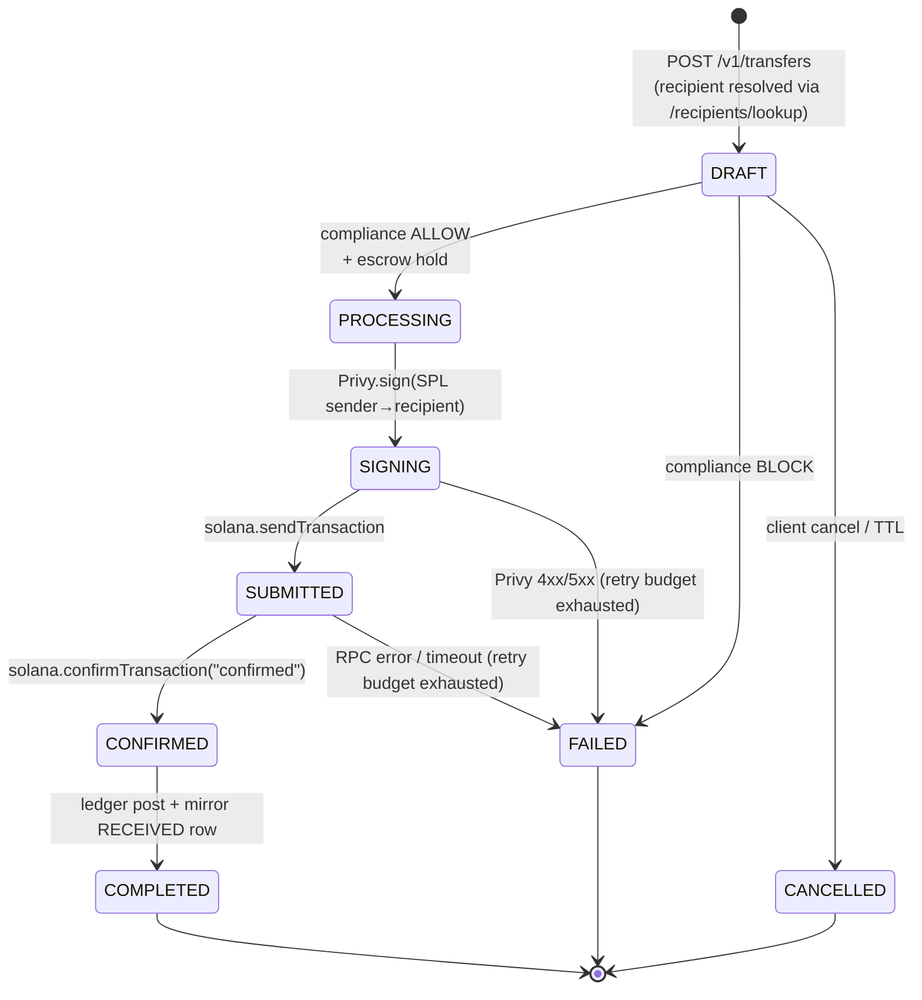
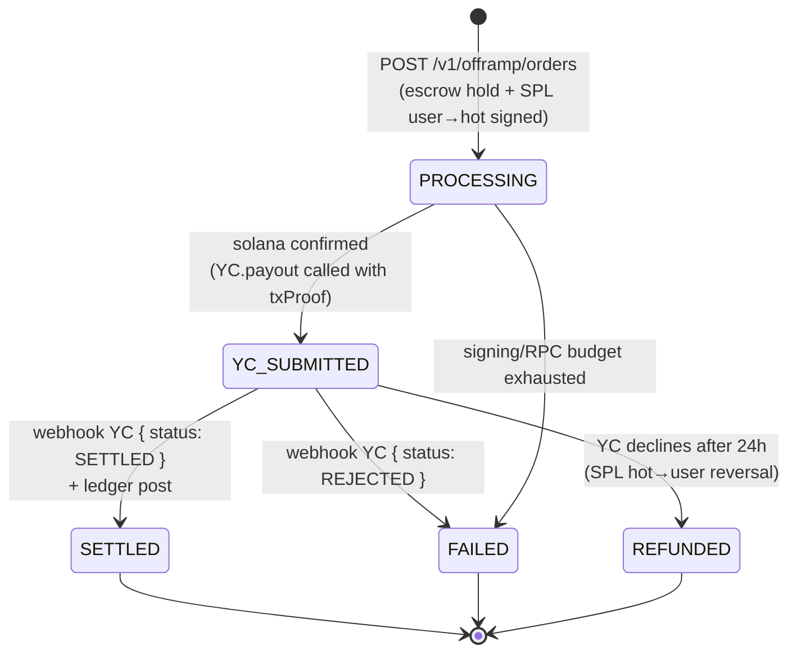
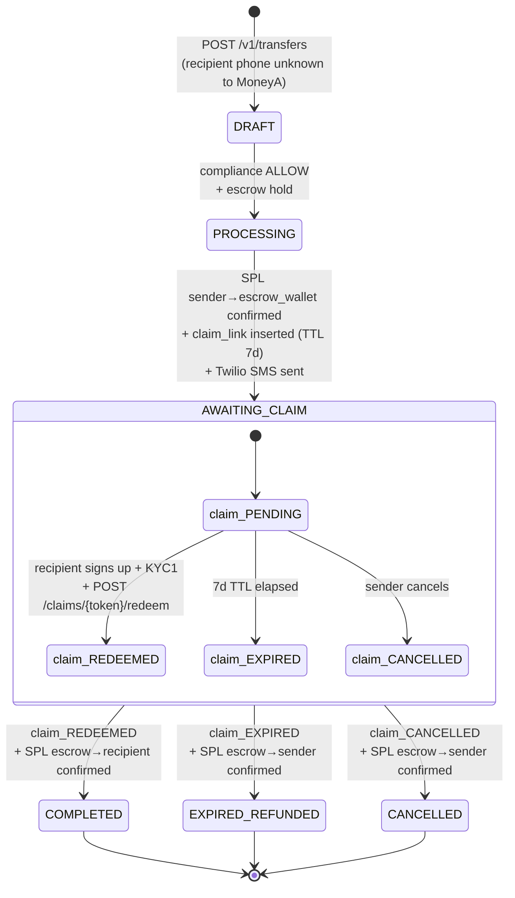

# MoneyA — Transfer State Machine

> **Status:** v1 (Phase 1 / Supabase deployment)
> **Owner:** Backend
> **Companion docs:** [`architecture.md`](./architecture.md) §6, [`openapi.yaml`](./openapi.yaml), [`migrations/0001_init.sql`](./migrations/0001_init.sql)

This document is the **single source of truth** for every state transition that
moves money in MoneyA. Every code path that mutates `app.transfers`,
`app.onramp_orders`, `app.offramp_orders`, `app.escrow_holds`, or
`app.claim_links` MUST conform to a transition listed here. Anything not
listed is forbidden and should be rejected at the service layer (and at the DB
layer wherever feasible — see §10).

---

## Table of contents

1. [Design principles](#1-design-principles)
2. [Entities & status enums](#2-entities--status-enums)
3. [Unified transfer FSM](#3-unified-transfer-fsm)
4. [In-network P2P transfer](#4-in-network-p2p-transfer)
5. [Onramp (mobile money → USDC)](#5-onramp-mobile-money--usdc)
6. [Offramp (USDC → mobile money)](#6-offramp-usdc--mobile-money)
7. [Unclaimed transfer & claim-link redemption](#7-unclaimed-transfer--claim-link-redemption)
8. [Resumer worker (recovery semantics)](#8-resumer-worker-recovery-semantics)
9. [Idempotency & retry rules](#9-idempotency--retry-rules)
10. [Invariants & DB-level enforcement](#10-invariants--db-level-enforcement)
11. [Edge cases & failure modes](#11-edge-cases--failure-modes)
12. [Observability](#12-observability)
13. [Open questions](#13-open-questions)

---

## 1. Design principles

| # | Principle | Why it matters |
|---|-----------|----------------|
| P1 | **Append-only event log.** Every state transition writes a row to `app.transfer_events`. The status column is denormalised; the log is the truth. | Auditability, debugging, regulator requests. |
| P2 | **Idempotency at every external boundary.** No external call (Privy sign, Solana send, Yellow Card collect/payout, Twilio SMS) is ever issued without a deterministic dedupe key. | Retries, resumer recovery, webhook replay. |
| P3 | **Resumability.** Any in-flight row must be resumable from any process crash by reading row state alone. No in-memory FSM coordination. | Stateless workers, horizontal scale, rolling deploys. |
| P4 | **Money is reserved before it moves.** Sender funds are held via `app.escrow_holds` (off-ledger reservation) the moment the transfer enters `PROCESSING`. | No double-spend, accurate available-balance UI. |
| P5 | **Ledger posts only on confirmed settlement.** Double-entry posts happen *after* on-chain confirmation or webhook settlement, never speculatively. | Ledger always matches on-chain reality. |
| P6 | **Time-bounded states.** Every non-terminal state has a `next_action_at` deadline. The resumer evicts stuck rows. | No silent stuck transfers. |
| P7 | **Step-up auth is single-use.** `X-Txn-Token` is consumed atomically when a transfer/onramp/offramp row is inserted. | Replay protection. |
| P8 | **Webhook handlers are state-aware.** A webhook can only drive a row forward, never backward. Out-of-order or duplicate webhooks are absorbed. | Yellow Card / Smile ID redelivery semantics. |

---

## 2. Entities & status enums

These mirror the SQL exactly. Source: `migrations/0001_init.sql:64-115`.

### 2.1 `app.transfers`

Single table for all four flows. Distinguished by `kind`.

```
kind   ::= SENT | RECEIVED | ONRAMP | OFFRAMP
status ::= DRAFT
         | PROCESSING
         | AWAITING_CLAIM
         | COMPLETED
         | FAILED
         | EXPIRED_REFUNDED
         | CANCELLED
```

Note: `RECEIVED` rows are mirror inserts created when the sender's transfer
completes, so the recipient sees a row in their list. The mirror row is
created in the same DB transaction as the `COMPLETED` transition (see §4.4).

### 2.2 `app.onramp_orders`

```
status ::= AWAITING_PAYMENT
         | COLLECTED
         | CREDITING_WALLET
         | COMPLETED
         | FAILED
         | EXPIRED
```

### 2.3 `app.offramp_orders`

```
status ::= PROCESSING
         | SETTLED
         | FAILED
         | REFUNDED
```

### 2.4 `app.claim_links`

```
status ::= PENDING | REDEEMED | EXPIRED | CANCELLED
```

### 2.5 Failure reason enum

Whenever any row transitions to `FAILED`, the `failure_reason` column MUST
be one of:

```
INSUFFICIENT_FUNDS | COMPLIANCE_BLOCK | SIGNING_FAILED | RPC_FAILED |
PROVIDER_REJECTED | QUOTE_EXPIRED | VELOCITY_LIMIT
```

### 2.6 Time budgets per state

| State | Max wall-clock | `next_action_at` set to | If exceeded |
|-------|----------------|-------------------------|-------------|
| `DRAFT` | 60 s | now + 60 s | Resumer flips to `CANCELLED` |
| `PROCESSING` (P2P) | 90 s | now + 30 s | Resumer re-checks signature; if not confirmed by 90 s → `FAILED(RPC_FAILED)` |
| `AWAITING_CLAIM` | 7 d | now + 7 d | Resumer triggers refund job → `EXPIRED_REFUNDED` |
| `onramp.AWAITING_PAYMENT` | 30 min | now + 30 min | Resumer flips to `EXPIRED` |
| `onramp.CREDITING_WALLET` | 90 s | now + 30 s | Resumer re-runs SPL credit |
| `offramp.PROCESSING` | 10 min | now + 60 s | Resumer polls YC; after 10 min escalate alert |

---

## 3. Unified transfer FSM



**Terminal states**: `COMPLETED`, `FAILED`, `EXPIRED_REFUNDED`, `CANCELLED`.
Once terminal, the row is immutable except for `updated_at` (no further status
changes; a refund of a `COMPLETED` row would be a *new* transfer of kind
`SENT` from MoneyA back to the user).

### 3.1 Transition table (canonical)

| From | To | Event / trigger | Guard | Side effects |
|------|----|-----------------|-------|--------------|
| ∅ | `DRAFT` | `POST /v1/transfers` | valid `Idempotency-Key`, valid `X-Txn-Token`, KYC ≥ 1, recipient ≠ self | Insert row, consume `txn_token`, write `transfer_events(null, DRAFT)` |
| `DRAFT` | `PROCESSING` | service step | compliance returns `ALLOW`; escrow hold insertable (sufficient available balance) | Insert `escrow_holds`, set `next_action_at = now()+30s`, log event |
| `DRAFT` | `FAILED` | service step | compliance `BLOCK` / insufficient funds / sanctions hit | `failure_reason` set, escrow NOT inserted, log event |
| `DRAFT` | `CANCELLED` | client `DELETE /v1/transfers/{id}` OR DRAFT TTL exceeded | row still in `DRAFT` | Log event |
| `PROCESSING` | `COMPLETED` | Solana `confirmTransaction` returns `confirmed` | `solana_signature` set on row, signature is for sender→recipient SPL of `amount_usdc` | Post double-entry ledger; release escrow hold; insert mirror `RECEIVED` row for recipient; emit WSS to both parties; enqueue push notifications |
| `PROCESSING` | `AWAITING_CLAIM` | Solana confirmed for sender→**escrow** wallet | `recipient_id IS NULL` AND `recipient_phone IS NOT NULL` | Insert `claim_links` row (TTL=7d), enqueue Twilio SMS, set `next_action_at = now()+7d` |
| `PROCESSING` | `FAILED` | Privy returns 4xx/5xx persistently OR Solana RPC fails after retry budget OR confirmation timeout | retry budget exhausted (see §9.3) | Release escrow hold (NO ledger post), `failure_reason` set, log event, push "Transfer failed" |
| `AWAITING_CLAIM` | `COMPLETED` | `POST /v1/claims/{token}/redeem` succeeds | claim PENDING, recipient KYC ≥ 1, escrow→recipient SPL confirmed | Update `claim_links.status=REDEEMED`; post ledger; insert mirror `RECEIVED` row; release escrow; notifications to both |
| `AWAITING_CLAIM` | `EXPIRED_REFUNDED` | resumer detects `now() > expires_at` | claim still PENDING | Sign escrow→sender SPL, confirm; on confirm: update `claim_links.status=EXPIRED`; release escrow; ledger post; notify sender |
| `AWAITING_CLAIM` | `CANCELLED` | sender `DELETE /v1/transfers/{id}` | claim PENDING, sender == row.sender_id | Same refund path as `EXPIRED_REFUNDED` but with `CANCELLED` end-state |

**Anything not in this table is rejected.** A trigger on `app.transfers`
enforces this (see §10.1).

---

## 4. In-network P2P transfer

### 4.1 Diagram



> `SIGNING`, `SUBMITTED`, `CONFIRMED` are **internal sub-states of `PROCESSING`**
> tracked by columns on the row (`solana_signature IS NULL` vs set), not by
> the `status` enum. The public API only exposes `PROCESSING`.

### 4.2 Pre-conditions (POST /v1/transfers)

All checked before any DB write:

1. Bearer token valid; `user_id = auth.uid()`.
2. `Idempotency-Key` header present, UUIDv4. Look up `app.idempotency_keys`:
   - **Hit + same request hash** → return cached response (no replay).
   - **Hit + different request hash** → 409 `IDEMPOTENCY_KEY_REUSED`.
   - **Miss** → insert with status `IN_FLIGHT`.
3. `X-Txn-Token` header present, valid, unconsumed, bound to
   `(user_id, device_id)`, age ≤ 60 s. Mark consumed atomically.
4. Sender KYC tier ≥ 1.
5. `amount_usdc > 0` and ≤ corridor limit (Phase 1: $1,000 / txn,
   $5,000 / day).
6. `recipient_phone != sender.phone`.
7. Available balance (wallet balance minus active escrow holds for sender)
   ≥ `amount_usdc + fee_usdc`. **This is checked but not yet binding** —
   the binding check is the `escrow_holds` insert under `SERIALIZABLE` in §4.3.

### 4.3 DRAFT → PROCESSING (atomic transaction)

```sql
BEGIN ISOLATION LEVEL SERIALIZABLE;
  -- 1. Compliance preflight (synchronous service call, idempotent).
  --    Returns ALLOW | REVIEW | BLOCK.
  --    REVIEW → still allowed at Phase 1 thresholds, flagged async.

  -- 2. Re-check available balance INSIDE the txn:
  SELECT app.user_available_balance(:sender_id, 'USDC') INTO v_avail;
  IF v_avail < (:amount + :fee) THEN
      RAISE EXCEPTION 'INSUFFICIENT_FUNDS';
  END IF;

  -- 3. Insert escrow hold (sender side).
  INSERT INTO app.escrow_holds (transfer_id, user_id, amount_usdc)
  VALUES (:transfer_id, :sender_id, :amount + :fee);

  -- 4. Update transfer row.
  UPDATE app.transfers
     SET status = 'PROCESSING',
         next_action_at = now() + interval '30 seconds'
   WHERE id = :transfer_id AND status = 'DRAFT';

  -- 5. Append event.
  INSERT INTO app.transfer_events (transfer_id, from_status, to_status, reason)
  VALUES (:transfer_id, 'DRAFT', 'PROCESSING', 'compliance_allow');
COMMIT;
```

If any step raises, the txn rolls back and a separate handler writes
`DRAFT → FAILED` with the appropriate `failure_reason`.

### 4.4 PROCESSING → COMPLETED (atomic transaction)

Triggered by the worker after `solana.confirmTransaction(sig, "confirmed")`
returns success.

```sql
BEGIN;
  -- 1. Idempotent guard: only proceed if signature matches and status still
  --    PROCESSING. A duplicate webhook / resumer call hits this and no-ops.
  UPDATE app.transfers
     SET status = 'COMPLETED',
         completed_at = now(),
         next_action_at = NULL
   WHERE id = :transfer_id
     AND status = 'PROCESSING'
     AND solana_signature = :sig
  RETURNING *;
  IF NOT FOUND THEN ROLLBACK; RETURN; END IF;

  -- 2. Release escrow hold.
  UPDATE app.escrow_holds
     SET released_at = now()
   WHERE transfer_id = :transfer_id AND released_at IS NULL;

  -- 3. Insert ledger journal (balance-to-zero — see ledger.md).
  --    sender USER_WALLET    -amount-fee
  --    recipient USER_WALLET +amount
  --    FEE_REVENUE           +fee
  INSERT INTO app.ledger_entries (...) VALUES (...);

  -- 4. Mirror RECEIVED row for recipient timeline.
  INSERT INTO app.transfers (id, sender_id, recipient_id, kind, status,
                             amount_usdc, solana_signature, ...)
  VALUES (:mirror_id, :sender_id, :recipient_id, 'RECEIVED', 'COMPLETED',
          :amount, :sig, ...);

  -- 5. Append event.
  INSERT INTO app.transfer_events (...)
  VALUES (:transfer_id, 'PROCESSING', 'COMPLETED', 'solana_confirmed');
COMMIT;

-- After commit (out-of-band):
--   - Emit WSS RealtimeEvent { type: TRANSFER_COMPLETED } to both parties.
--   - Enqueue notifications.
```

### 4.5 PROCESSING → FAILED

Triggered by:

- Privy returns non-retryable error (4xx not in [408, 429]).
- Solana RPC budget exhausted (see §9.3).
- Confirmation deadline (90 s) elapsed without `confirmed` status.

```sql
BEGIN;
  UPDATE app.transfers
     SET status = 'FAILED',
         failure_reason = :reason,
         next_action_at = NULL
   WHERE id = :transfer_id AND status = 'PROCESSING';
  UPDATE app.escrow_holds
     SET released_at = now()
   WHERE transfer_id = :transfer_id AND released_at IS NULL;
  -- NO ledger post: nothing settled.
  INSERT INTO app.transfer_events (...) VALUES (...);
COMMIT;
```

> ⚠️ **Critical:** if the SPL transfer was *submitted but not confirmed* and
> the worker hits the 90 s deadline, it MUST NOT immediately mark `FAILED`.
> It MUST first poll `getSignatureStatuses` one final time. If "confirmed"
> or "finalized" → drive to `COMPLETED`. If "processed" only → extend
> deadline by 30 s, retry once. If after that still not confirmed → mark
> `FAILED(RPC_FAILED)` and enqueue an **operator alert** (the funds may
> still settle later; manual reconciliation needed). See §11.3.

---

## 5. Onramp (mobile money → USDC)

### 5.1 Diagram

```mermaid
stateDiagram-v2
    [*] --> AWAITING_PAYMENT: POST /v1/onramp/orders<br/>(YC.collect → checkoutUrl)
    AWAITING_PAYMENT --> COLLECTED: webhook YC { status: COLLECTED }
    AWAITING_PAYMENT --> EXPIRED: 30min TTL<br/>OR webhook { status: EXPIRED }
    AWAITING_PAYMENT --> FAILED: webhook YC { status: REJECTED }<br/>OR compliance BLOCK post-quote
    COLLECTED --> CREDITING_WALLET: worker picks up<br/>(Privy.sign hot→user)
    CREDITING_WALLET --> COMPLETED: solana confirmed<br/>+ ledger post
    CREDITING_WALLET --> FAILED: signing/RPC budget exhausted<br/>(operator alert; YC keeps fiat)
    COMPLETED --> [*]
    FAILED --> [*]
    EXPIRED --> [*]
```



### 5.2 Transitions

| From | To | Event | Side effects |
|------|----|-------|--------------|
| ∅ | `AWAITING_PAYMENT` | `POST /v1/onramp/orders` succeeds; YC returns `checkoutUrl` | Consume txn_token; ledger pre-hold (`SUSPENSE +amount` / off-balance); set `next_action_at = now()+30min` |
| `AWAITING_PAYMENT` | `COLLECTED` | YC webhook `{ status: COLLECTED }` | Verify HMAC; dedupe via `audit.webhook_events`; set `next_action_at = now()` (immediate worker pickup) |
| `AWAITING_PAYMENT` | `EXPIRED` | TTL or YC `{ status: EXPIRED }` | Reverse SUSPENSE pre-hold |
| `AWAITING_PAYMENT` | `FAILED` | YC `{ status: REJECTED }` | Reverse SUSPENSE pre-hold; `failure_reason=PROVIDER_REJECTED` |
| `COLLECTED` | `CREDITING_WALLET` | worker claims row | Privy.sign(SPL hot→user, amount_usdc); set `next_action_at = now()+30s` |
| `CREDITING_WALLET` | `COMPLETED` | solana confirmed | Ledger: `SUSPENSE -amount`, `USER_WALLET +amount`, `FEE_REVENUE +fee` |
| `CREDITING_WALLET` | `FAILED` | RPC budget exhausted after `COLLECTED` | **Operator alert (P1).** Funds collected by YC but not credited. Manual remediation required. |

### 5.3 Webhook idempotency

Yellow Card webhook handler:

```ts
async handleYcWebhook(req) {
  // 1. Verify HMAC SHA-256 over raw body using YC_WEBHOOK_SECRET.
  // 2. Dedupe:
  await db.insert('audit.webhook_events', {
    provider: 'yellow_card',
    event_id: req.body.event_id,   // unique constraint
    received_at: now(),
    raw_payload: rawBody,
  }).onConflictDoNothing();
  // If conflict (already seen) → return 200 immediately.

  // 3. Look up the order, drive FSM forward by one step. Never backward.
  // 4. Return 200 only after enqueue, not after worker completion.
}
```

---

## 6. Offramp (USDC → mobile money)

### 6.1 Diagram



> `YC_SUBMITTED` is an internal sub-state of `PROCESSING` tracked by
> `yc_order_id IS NOT NULL`. The public API exposes only `PROCESSING`,
> `SETTLED`, `FAILED`, `REFUNDED`.

### 6.2 Transitions

| From | To | Event | Side effects |
|------|----|-------|--------------|
| ∅ | `PROCESSING` | `POST /v1/offramp/orders` | Consume txn_token; insert `escrow_holds` (sender side); enqueue Privy.sign(SPL user→hot) |
| `PROCESSING` (pre-YC) | `FAILED` | RPC budget exhausted before YC.payout | Release escrow; `failure_reason=RPC_FAILED`; no funds left customer wallet |
| `PROCESSING` (post-SPL confirmed) | `YC_SUBMITTED` (still `PROCESSING` publicly) | YC.payout returns `{ orderId, status: PROCESSING }` | Persist `yc_order_id`; ledger post `USER_WALLET -amount`, `SUSPENSE +amount`; release escrow |
| `YC_SUBMITTED` | `SETTLED` | YC webhook `{ status: SETTLED }` | Ledger post `SUSPENSE -amount`, `YC_PAYABLE +amount` |
| `YC_SUBMITTED` | `FAILED` | YC webhook `{ status: REJECTED }` ≤ 24 h after submit | Trigger refund: Privy.sign(SPL hot→user, amount); on confirm → `REFUNDED`; ledger reversal |
| `YC_SUBMITTED` | `REFUNDED` | refund SPL confirmed | Final state |

### 6.3 Critical ordering

For offramp, the SPL transfer (user → hot) MUST be confirmed on Solana
**before** YC.payout is called. Otherwise we'd be paying out fiat against
unconfirmed crypto. The signature is included in the YC.payout payload
as `txProof`.

---

## 7. Unclaimed transfer & claim-link redemption

### 7.1 Diagram



### 7.2 Claim link lifecycle

`app.claim_links` row is 1:1 with the parent `transfers` row.

```
PENDING ─────► REDEEMED   (recipient redeemed within TTL)
PENDING ─────► EXPIRED    (TTL elapsed; resumer flipped status)
PENDING ─────► CANCELLED  (sender cancelled before claim)
```

Token: opaque, ≥ 128 bits entropy, single-use, stored hashed in DB
(`token_hash`), plaintext only in SMS link `https://m.moneya.app/c/<token>`.

### 7.3 Redeem flow (POST /v1/claims/{token}/redeem)

Pre-conditions:

1. Bearer token valid; recipient is signed up & KYC tier ≥ 1.
2. Claim link found by `token_hash = sha256(:token)`, status = `PENDING`,
   `expires_at > now()`.
3. Recipient phone (KYC-verified) matches `claim_links.recipient_phone`.
   *Mismatch → 403; do not leak existence.*

Atomic transaction:

```sql
BEGIN;
  UPDATE app.claim_links
     SET status = 'REDEEMED', redeemed_at = now(), recipient_id = :recipient_id
   WHERE id = :claim_id AND status = 'PENDING';
  IF NOT FOUND THEN ROLLBACK; RAISE EXCEPTION 'CLAIM_NOT_PENDING'; END IF;

  -- Mark parent transfer for SPL escrow→recipient.
  UPDATE app.transfers
     SET recipient_id = :recipient_id,
         next_action_at = now()
   WHERE id = :transfer_id AND status = 'AWAITING_CLAIM';
COMMIT;

-- After commit, worker picks up:
--   1. Privy.sign(SPL escrow_wallet → recipient_wallet, amount)
--   2. solana.send + confirm
--   3. On confirm: transfers.status = COMPLETED, ledger post,
--      mirror RECEIVED row, push notifications.
```

### 7.4 Expiry refund (resumer-driven)

```sql
-- Run every 60s by pg-boss cron.
SELECT cl.id, t.id AS transfer_id, t.sender_id, t.amount_usdc
  FROM app.claim_links cl
  JOIN app.transfers t ON t.id = cl.transfer_id
 WHERE cl.status = 'PENDING'
   AND cl.expires_at < now()
 LIMIT 100
 FOR UPDATE SKIP LOCKED;
```

For each row → enqueue refund job that:

1. Privy.sign(SPL escrow → sender_wallet, amount).
2. On confirm: atomic txn → `claim_links.status = EXPIRED`,
   `transfers.status = EXPIRED_REFUNDED`, ledger reversal, release escrow,
   notify sender.

### 7.5 Sender cancel (DELETE /v1/transfers/{id})

Allowed only when `status = AWAITING_CLAIM`. Same SPL escrow→sender refund
path as expiry, but end-state = `CANCELLED` instead of `EXPIRED_REFUNDED`.

---

## 8. Resumer worker (recovery semantics)

### 8.1 Job

A pg-boss cron (Phase 1) / SQS-triggered Lambda (Phase 2) runs every 30
seconds:

```sql
-- All stuck rows across all flows.
SELECT id, kind, status, solana_signature, yc_order_id, retry_count
  FROM app.transfers
 WHERE status IN ('DRAFT', 'PROCESSING', 'AWAITING_CLAIM')
   AND next_action_at < now()
 LIMIT 200
 FOR UPDATE SKIP LOCKED;
```

Plus equivalent queries on `onramp_orders`, `offramp_orders`, `claim_links`.

### 8.2 Per-row dispatch

```python
def resume(row):
    if row.kind == 'SENT' and row.status == 'PROCESSING':
        if row.solana_signature is None:
            # Privy.sign never fired or was lost. Re-sign with same
            # idempotency key (transfer.id) — Privy dedupes server-side.
            sign_and_send(row)
        else:
            # Signature exists. Poll Solana.
            status = solana.get_signature_statuses([row.solana_signature])
            if status == 'confirmed' or status == 'finalized':
                drive_to_completed(row)
            elif status == 'processed':
                extend_deadline(row, 30)
            elif status is None and (now() - row.created_at) > 90s:
                drive_to_failed(row, 'RPC_FAILED', alert=True)
            else:
                extend_deadline(row, 30)

    elif row.status == 'AWAITING_CLAIM' and row.expires_at < now():
        enqueue_refund(row)

    elif row.kind == 'ONRAMP' and row.status == 'COLLECTED':
        # Webhook arrived but worker crashed before crediting.
        sign_and_credit(row)

    # ... etc per flow.
```

### 8.3 Resumer correctness invariants

- **R1.** Resumer is the *only* component that may transition a row past its
  `next_action_at`. Live workers handle the synchronous path.
- **R2.** Every external call from the resumer uses the same idempotency
  key as the original — Privy dedupes server-side, Solana dedupes by
  signature, YC dedupes by order_id.
- **R3.** Resumer never enters a terminal state (`COMPLETED`, `FAILED`)
  without first verifying external truth (Solana signature status, YC
  webhook event_id, etc.). Speculation is forbidden.
- **R4.** Resumer increments `retry_count`. After `retry_count > 5`, the
  row is moved to a *quarantine* status (`FAILED` with `failure_reason`
  but tagged `requires_manual_review = true`) and an operator alert is
  fired.

---

## 9. Idempotency & retry rules

### 9.1 `Idempotency-Key` (client → API)

| Property | Value |
|----------|-------|
| Format | UUIDv4 |
| Header | `Idempotency-Key` |
| Scope | (user_id, endpoint, key) |
| Window | 24 h |
| Storage | `app.idempotency_keys (key, user_id, endpoint, request_hash, response_status, response_body, created_at)` |
| Replay (same hash) | Return cached response verbatim |
| Replay (different hash) | 409 `IDEMPOTENCY_KEY_REUSED` |
| Endpoints | `POST /v1/transfers`, `POST /v1/onramp/orders`, `POST /v1/offramp/orders`, `POST /v1/payment-requests`, `POST /v1/claims/{token}/redeem` |

### 9.2 `X-Txn-Token` (step-up)

| Property | Value |
|----------|-------|
| Issued by | `POST /v1/auth/step-up` (passcode or biometric) |
| Lifetime | 60 s |
| Bound to | (user_id, device_id) |
| Single-use | Yes — consumed atomically when row is inserted |
| Storage | `app.txn_tokens (token_hash, user_id, device_id, issued_at, expires_at, consumed_at)` |
| Required on | `POST /v1/transfers`, `POST /v1/onramp/orders`, `POST /v1/offramp/orders` |

### 9.3 External call retry budgets

| External call | Retry policy | Total budget | After exhaustion |
|---------------|--------------|--------------|------------------|
| Privy `sign` | Exponential backoff, base 500ms, factor 2, jitter ±25% | 5 attempts / 30s | `FAILED(SIGNING_FAILED)` |
| Solana `sendTransaction` | Linear backoff 1s | 3 attempts | Re-sign with new blockhash; counts toward Privy budget |
| Solana `getSignatureStatuses` | Polling 2s interval | until `next_action_at` | Resumer re-checks |
| Solana `confirmTransaction` | Built-in poller, commitment="confirmed" | 60s timeout per attempt | Resumer takes over |
| Yellow Card REST | Exponential backoff, base 1s, factor 2 | 3 attempts / 15s | `FAILED(PROVIDER_REJECTED)` if 4xx, retry-on-resumer if 5xx |
| Twilio Verify | 2 attempts | 10s | Surface 503 to client |
| Twilio SMS (claim link) | pg-boss retry, exponential | 5 attempts / 1h | Quarantine + operator alert (claim still valid; user can be re-notified manually) |
| Smile ID submit | 2 attempts | 30s | Mark KYC submission `FAILED`, user retries |

### 9.4 Webhook retry handling (provider → us)

| Provider | Retry policy | Our handler |
|----------|--------------|-------------|
| Yellow Card | Exponential, up to 24h | Dedupe on `event_id`, drive forward only, return 200 after enqueue |
| Smile ID | Up to 5 attempts over 1h | Same |
| Privy | (none — we poll) | n/a |

---

## 10. Invariants & DB-level enforcement

### 10.1 Forbidden transitions

A trigger on `app.transfer_events` BEFORE INSERT validates `(from_status,
to_status)` against an allowlist table:

```sql
CREATE TABLE app._allowed_transfer_transitions (
    from_status app.transfer_status,
    to_status   app.transfer_status,
    PRIMARY KEY (from_status, to_status)
);

INSERT INTO app._allowed_transfer_transitions VALUES
    (NULL,             'DRAFT'),
    ('DRAFT',          'PROCESSING'),
    ('DRAFT',          'FAILED'),
    ('DRAFT',          'CANCELLED'),
    ('PROCESSING',     'COMPLETED'),
    ('PROCESSING',     'AWAITING_CLAIM'),
    ('PROCESSING',     'FAILED'),
    ('AWAITING_CLAIM', 'COMPLETED'),
    ('AWAITING_CLAIM', 'EXPIRED_REFUNDED'),
    ('AWAITING_CLAIM', 'CANCELLED');

CREATE OR REPLACE FUNCTION app.check_transfer_transition()
RETURNS TRIGGER AS $$
BEGIN
    IF NOT EXISTS (
        SELECT 1 FROM app._allowed_transfer_transitions
         WHERE from_status IS NOT DISTINCT FROM NEW.from_status
           AND to_status   = NEW.to_status
    ) THEN
        RAISE EXCEPTION 'Forbidden transfer transition: % -> %',
            NEW.from_status, NEW.to_status;
    END IF;
    RETURN NEW;
END;
$$ LANGUAGE plpgsql;

CREATE TRIGGER transfer_events_validate_transition
    BEFORE INSERT ON app.transfer_events
    FOR EACH ROW EXECUTE FUNCTION app.check_transfer_transition();
```

> ☑ **Action item for migration `0002_state_machine.sql`** — to be authored
> alongside service implementation.

### 10.2 Append-only

`app.transfer_events`, `app.ledger_entries`, `audit.audit_log` already
reject UPDATE/DELETE via `app.deny_modification` trigger
(`migrations/0001_init.sql:471-473`).

### 10.3 Escrow consistency

`app.user_available_balance(user_id, currency)` view/function:

```sql
ledger_balance(user_id, currency)
  - SUM(active escrow_holds for user)
```

Service layer MUST consult this — never raw `wallets.balance`.

### 10.4 Ledger balance-to-zero

Already enforced by `app.ledger_journal_balance_check` DEFERRABLE
constraint trigger (`migrations/0001_init.sql`). Every `journal_id`
sums to zero per currency.

### 10.5 No double settlement

`UPDATE app.transfers SET status='COMPLETED' WHERE id=:id AND status='PROCESSING'`
plus `RETURNING` is the canonical guard. If `RETURNING` is empty, abort —
another worker beat us to it.

---

## 11. Edge cases & failure modes

### 11.1 Recipient signs up after PROCESSING but before AWAITING_CLAIM

Race: sender posts transfer with `recipient_phone` not yet known to
MoneyA. Worker is mid-flight (`PROCESSING`). Recipient signs up.

**Resolution:** the SPL has already been signed for `sender → escrow_wallet`
(decided at `DRAFT → PROCESSING` based on `recipient_id IS NULL`). The
transfer completes to `AWAITING_CLAIM`. The new user receives the SMS
claim link normally (Twilio fires post-SPL-confirmation) and redeems it.
**No special handling needed.**

### 11.2 Sender cancels mid-PROCESSING

**Not allowed.** API rejects `DELETE /v1/transfers/{id}` if
`status != AWAITING_CLAIM`. Once SPL is signed, cancellation is a refund
flow — and refund is only meaningful from `AWAITING_CLAIM` (escrow holds
the funds). For P2P, by the time SPL is signed, funds are gone from
sender; recipient gets them; no cancel.

### 11.3 SPL submitted, never confirmed (gray zone)

Worker submits, network drops, `getSignatureStatuses` returns null after
90s. Two possibilities:

- **Tx never landed**: blockhash will expire in ~90s; safe to consider
  failed. Resumer retries with new blockhash.
- **Tx landed but RPC inconsistent**: tx will eventually confirm. If we
  re-sign and re-submit, we'd double-spend.

**Mitigation:**

1. Worker MUST wait full 150 s before re-signing (blockhash expiry +
   buffer).
2. Before re-signing, query at least 2 RPC providers
   (Helius primary, QuickNode backup).
3. If still null after 150 s and 2 providers → re-sign with NEW
   blockhash. Solana will reject the original if it later lands
   (blockhash expired).
4. If both signatures somehow confirm (extremely unlikely) →
   reconciliation job catches via daily on-chain scan and posts
   compensating ledger.

### 11.4 Yellow Card webhook arrives before worker stores `yc_order_id`

Race: YC.payout returns synchronously with `orderId` AND fires webhook
nearly simultaneously, before the service has persisted the `orderId`.

**Mitigation:** webhook handler retries lookup up to 5s with 100ms backoff
if `WHERE yc_order_id = $1` returns no row. After 5s → store webhook in
`audit.webhook_events` but return 200 (already deduped); resumer picks
up the order on next sweep.

### 11.5 Onramp `COLLECTED` but Privy/Solana down

User paid, YC has the fiat, but we can't credit USDC.

**Behaviour:**

1. Row stays in `COLLECTED`. Resumer keeps retrying every 30s.
2. After 10 minutes → operator P1 alert.
3. After 1 hour → automated message to user: "Top-up delayed, funds
   safe, will credit within 24h."
4. Manual remediation: ops uses break-glass tool to credit from a
   different hot wallet OR refund via YC reversal.

**Never** mark `FAILED` automatically in this state — that would imply
fiat is returnable when it's not.

### 11.6 Idempotent retry with concurrent original

Client sends `POST /v1/transfers` with key `K`, doesn't get response,
retries with same `K`. If the first request is still in-flight:

- Insert into `idempotency_keys` with `status='IN_FLIGHT'` uses
  `ON CONFLICT (key, user_id) DO NOTHING`.
- If conflict + first request still `IN_FLIGHT` → return **409
  `REQUEST_IN_FLIGHT`**, advise client to poll
  `GET /v1/transfers?idempotency_key=K`.
- If conflict + first request `COMPLETED` → return cached response.

### 11.7 Compliance flips to `BLOCK` after `DRAFT` but before `PROCESSING`

Transfer rejected. `DRAFT → FAILED(COMPLIANCE_BLOCK)`. Sender notified
with generic message (do not reveal AML triggers). Compliance team
notified internally.

### 11.8 Self-transfer

Pre-condition check (§4.2 #6) catches this. 400
`SELF_TRANSFER_NOT_ALLOWED`.

### 11.9 Recipient KYC drops below tier 1 between AWAITING_CLAIM and redeem

E.g., we discover sanctions match on the new user.

**Behaviour:** redeem endpoint checks `recipient.kyc_tier >= 1` AND
`compliance.preflight(recipient_id)`. If blocked → 403, claim stays
PENDING, eventually expires → refund to sender.

### 11.10 Solana fee account exhausted

Privy custodial wallets are gas-funded by MoneyA. If gas wallet runs dry:

- All sign attempts fail with `INSUFFICIENT_FEE`.
- Operator alert P0.
- Resumer keeps in-flight rows in `PROCESSING` (does NOT mark FAILED).
- Once gas refunded → resumer drains queue.

---

## 12. Observability

### 12.1 Required metrics (per flow)

| Metric | Type | Labels |
|--------|------|--------|
| `transfers_created_total` | counter | `kind`, `status` |
| `transfers_state_transitions_total` | counter | `from`, `to`, `kind` |
| `transfers_in_flight` | gauge | `status`, `kind` |
| `transfer_duration_seconds` | histogram | `kind` (DRAFT→COMPLETED wall time) |
| `transfer_failures_total` | counter | `kind`, `failure_reason` |
| `external_call_duration_seconds` | histogram | `provider` (privy/solana/yc/smile/twilio) |
| `external_call_errors_total` | counter | `provider`, `error_kind` |
| `resumer_rows_picked_total` | counter | `kind`, `status` |
| `resumer_quarantine_total` | counter | `kind`, `failure_reason` |
| `escrow_active_holds_usdc` | gauge | (sum of active holds) |
| `claim_links_pending` | gauge | |
| `claim_links_expired_total` | counter | |

### 12.2 Required alerts

| Alert | Condition | Severity |
|-------|-----------|----------|
| Onramp stuck in `COLLECTED` | row.age > 10 min | P1 |
| Solana confirmations slow | p99 confirm > 60s | P2 |
| Privy error rate | > 1% over 5 min | P1 |
| Privy gas wallet low | balance < 0.5 SOL | P1 |
| Privy gas wallet empty | balance < 0.05 SOL | P0 |
| Resumer quarantine | any row enters quarantine | P1 |
| Yellow Card webhook lag | now - last_webhook > 5 min during business hours | P2 |
| Ledger imbalance | `app.v_ledger_imbalance` returns rows | P0 |
| Escrow > wallet balance | any user's escrow > on-chain balance | P0 |

### 12.3 Tracing

Every transfer carries a `trace_id` (W3C `traceparent`) propagated to:

- Privy API calls (custom header).
- Solana RPC (logged client-side, not propagated — RPC doesn't support).
- Yellow Card / Smile ID / Twilio (custom header where supported).
- Push notification metadata.

Span structure for a P2P transfer:

```
POST /v1/transfers
├── compliance.preflight
├── db.tx (DRAFT → PROCESSING)
├── privy.sign
├── solana.sendTransaction
├── solana.confirmTransaction
└── db.tx (PROCESSING → COMPLETED)
    ├── ledger.post
    ├── insert mirror RECEIVED
    └── notifications.enqueue
```

---

## 13. Open questions

| # | Question | Owner | Decision deadline |
|---|----------|-------|--------------------|
| Q1 | Should we offer "Cancel" UX in the app for `AWAITING_CLAIM` transfers, or only auto-expire? | Product | Phase 1 launch |
| Q2 | Velocity limits per corridor — exact thresholds for tier 1 KYC? | Compliance | Phase 1 launch |
| Q3 | Compliance `REVIEW` decision — block synchronously or allow + flag? Current design = allow + flag at Phase 1 thresholds. | Compliance | Phase 1 launch |
| Q4 | Escrow wallet sharding — single wallet vs per-corridor for Phase 2? | Backend | Phase 2 design |
| Q5 | Should the resumer also poll YC for offramp settlement (in addition to webhook)? Belt-and-suspenders vs duplicate work. | Backend | Phase 1 implementation |
| Q6 | Mirror `RECEIVED` row — should it carry the same `id` or be linked via FK? Current = separate UUID, link via `parent_transfer_id` (column to add in `0002_state_machine.sql`). | Backend | Migration 0002 |
| Q7 | Operator break-glass tooling spec — separate doc or part of admin runbook? | Backend | Phase 1 launch |

---

**End of state machine spec.** Companion docs to author next:
- `docs/backend/ledger.md` — double-entry account taxonomy + entry templates per transition listed here
- `docs/backend/webhooks.md` — provider-specific contract details
- `docs/backend/backlog.md` — Phase 1 ticketed implementation order
